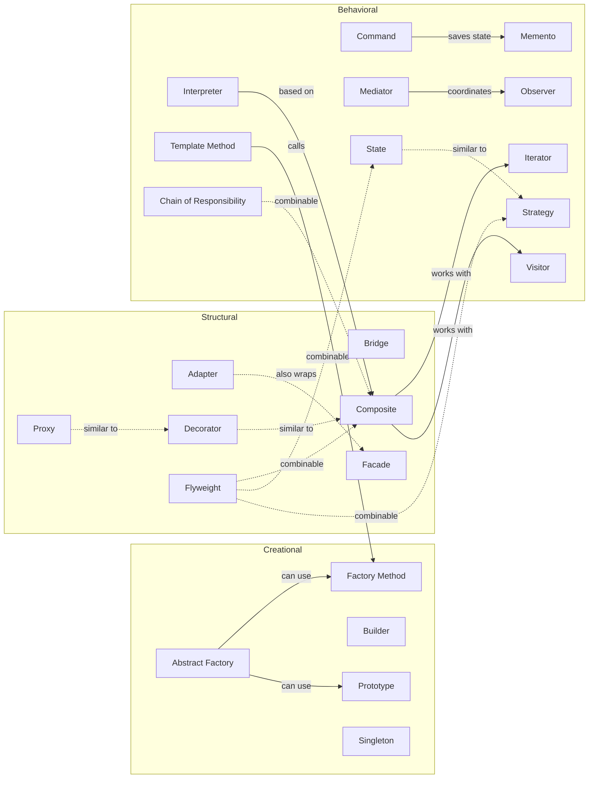

# 🧩 23 Design Patterns (Java)

English | [简体中文](README_zh.md)

A Java implementation and learning project for the GoF 23 design patterns: every pattern comes with documentation, runnable cases, and a graphical interface — ideal for systematically learning and reviewing design patterns.

[](LICENSE)
[](https://openjdk.org/)
[](https://maven.apache.org/)

## About

Built with **Java 21** and **Maven**, this project covers all 23 design patterns from the GoF book. For every pattern it provides:

- **Pattern documentation**: a systematic walkthrough from intent → problem → solution → structure → consequences, with Mermaid structure diagrams;
- **Runnable cases**: realistic example code that can be run in one click from the GUI to observe the output;
- **Graphical interface**: a case tree on the left, documentation and output on the right — click to read and run;
- **Internationalization**: UI labels, case output, and documentation all follow an i18n architecture that can be smoothly extended to more languages.

## Project Structure

```
design-patternz/                              # Maven project (Java 21)
├── pom.xml                                   # Build configuration
└── src/main/java/com/zhuzz/design/
    ├── lab/                                  # Framework: GUI, i18n, README rendering, case discovery
    └── patternz/                             # Cases: 23 design patterns, one package per pattern
```

- `lab`: the general-purpose framework — GUI, internationalization, README rendering, and automatic case discovery — decoupled from any specific pattern;
- `patternz`: the 23 design pattern cases, one package per pattern, discovered automatically at startup with no manual registration.

## Getting Started

### Requirements

- JDK 21 (`JAVA_HOME` pointing to a JDK 21 installation)
- No Maven installation needed — the project ships with the Maven Wrapper

### Build

```bash
# Windows
.\mvnw.cmd clean compile

# Linux / macOS
./mvnw clean compile
```

### Run

Option 1 (recommended): open the project in your IDE and run the `main` method of `com.zhuzz.design.lab.Launcher`.

Option 2 (command line; the exec plugin is downloaded on first use):

```bash
./mvnw org.codehaus.mojo:exec-maven-plugin:3.1.0:java \
  -Dexec.mainClass=com.zhuzz.design.lab.Launcher
```

Option 3 (run a single case directly, without the GUI):

In IntelliJ IDEA, open any `*Demo` class and click the green run button next to the class name to run it directly. You can also pass arguments in the Run Configuration's "Program arguments" field, e.g. `--op=Multiplication --a=6 --b=7`.

Or run it from the command line:

```bash
# Compile first
.\mvnw.cmd clean compile

# Run any case by its fully qualified class name
java -cp target/classes com.zhuzz.design.patternz.decorator.datastream.DataStreamDemo

# Pass inputs with --key=value or --key value; unprovided inputs use their defaults
java -cp target/classes com.zhuzz.design.patternz.strategy.calculator.CalculatorDemo --op=Multiplication --a=6 --b=7

# Switch the output language (en / zh)
java -cp target/classes com.zhuzz.design.patternz.strategy.calculator.CalculatorDemo --op=Subtraction --a=10 --b=3 --lang=en

# Show available inputs and choices
java -cp target/classes com.zhuzz.design.patternz.strategy.payment.PaymentDemo --help
```

Every `*Demo` class extends `com.zhuzz.design.lab.DemoSupport`, which provides a shared `main` method, so any case can be launched standalone with `java <fully-qualified-class-name>`.

### Using the GUI

- **Case tree (left)**: grouped by Creational / Structural / Behavioral, drill down to patterns and cases;
- **Click a pattern node**: the right side shows that pattern's documentation (including a Mermaid structure diagram);
- **Click a case node**: shows the case documentation, with a "Run" button to execute the example and observe the output;
- **Toolbar**: switch the interface language and clear the output.

## What Are Design Patterns

Design patterns are general, reusable solutions to problems that recur in software design. They are guidelines that have been validated and applied many times, and they aim to help developers solve particular kinds of problems while improving the maintainability, extensibility, and reusability of code.

A design pattern is an abstract way of thinking that helps developers better organize and structure their code. It provides a general framework that can be applied to many different software design problems. A design pattern is not complete code, but rather a template describing the relationship between a problem and its solution.

Design patterns are not rigid laws; whether and how to use one depends on the specific problem and context. Understanding and applying design patterns helps developers organize code better, improves readability and maintainability, and also fosters collaboration and communication within a team.

## Why Learn Design Patterns in the AI Era

With AI-assisted programming becoming increasingly common, more and more "writing code" work can be delegated to AI — which actually makes design patterns more valuable:

- **They are the common language for collaborating with AI.** When you ask an AI to generate, refactor, or review code, the precision with which you can describe your intent using terms like "Factory Method" or "Observer" directly determines the quality of the output. Reading, evaluating, and fixing AI-generated code depends on these concepts too.
- **They teach decision-making, not just coding.** AI can write the code for a pattern, but deciding whether to use one, which one to use, and how to weigh the trade-offs remains a human responsibility. The core value of design patterns lies precisely in analyzing problems and making trade-offs — something AI cannot do for you.
- **They cultivate transferable, structural thinking.** At their core, design patterns are a set of methods for abstracting, decoupling, and layering problems. These skills do not become obsolete as tools improve — on the contrary, they become an even scarcer competitive advantage in the AI era.
- **They are a passport to reading open-source projects and collaborating.** Many mainstream frameworks (such as Spring, Guava, and the JDK itself) are "living textbooks" of design patterns. Reading their source code and participating in the community both depend on design patterns.

## Categories of Design Patterns

Design patterns are commonly grouped by purpose into three categories:

1. **Creational patterns** focus on the object instantiation process, including how objects are created and how creation details are hidden. Common examples include Singleton, Factory Method, and Abstract Factory.
2. **Structural patterns** focus on how objects are composed to build larger structures. They help you define relationships between objects to achieve larger structures. Common examples include Adapter, Decorator, and Proxy.
3. **Behavioral patterns** focus on how objects communicate and cooperate to accomplish tasks. They involve interaction between objects and responsibility assignment. Common examples include Observer, Strategy, and Command.

## Essential Elements of a Design Pattern

Every design pattern has four essential elements, and the documentation for each pattern in this project follows exactly this structure:

1. **Pattern name**: each pattern has a concise name that describes the problem, the solution, and the consequences. The name helps refer to the pattern quickly in conversation.
2. **Problem**: describes when a particular pattern should be considered, spelling out the specific design difficulty it aims to solve.
3. **Solution**: provides a detailed design guide describing how to organize classes, objects, and their relationships to solve the problem, including the responsibilities of each role and how they collaborate.
4. **Consequences**: describes the results of applying the pattern and the trade-offs to weigh.

## Overview of the 23 Patterns

### Creational (5)

| Pattern | Intent |
| --- | --- |
| [Factory Method](design-patternz/src/main/java/com/zhuzz/design/patternz/factorymethod/README.md) | Define an interface for creating objects, letting subclasses decide which class to instantiate |
| [Abstract Factory](design-patternz/src/main/java/com/zhuzz/design/patternz/abstractfactory/README.md) | Provide an interface for creating families of related objects without specifying their concrete classes |
| [Builder](design-patternz/src/main/java/com/zhuzz/design/patternz/builder/README.md) | Separate the construction of a complex object from its representation |
| [Prototype](design-patternz/src/main/java/com/zhuzz/design/patternz/prototype/README.md) | Create new objects by copying an existing instance |
| [Singleton](design-patternz/src/main/java/com/zhuzz/design/patternz/singleton/README.md) | Ensure a class has only one instance and provide a global point of access to it |

### Structural (7)

| Pattern | Intent |
| --- | --- |
| [Adapter](design-patternz/src/main/java/com/zhuzz/design/patternz/adapter/README.md) | Convert the interface of a class into another interface clients expect |
| [Bridge](design-patternz/src/main/java/com/zhuzz/design/patternz/bridge/README.md) | Decouple an abstraction from its implementation so that the two can vary independently |
| [Composite](design-patternz/src/main/java/com/zhuzz/design/patternz/composite/README.md) | Compose objects into tree structures to represent part-whole hierarchies |
| [Decorator](design-patternz/src/main/java/com/zhuzz/design/patternz/decorator/README.md) | Attach additional responsibilities to an object dynamically |
| [Facade](design-patternz/src/main/java/com/zhuzz/design/patternz/facade/README.md) | Provide a unified high-level interface to a subsystem |
| [Flyweight](design-patternz/src/main/java/com/zhuzz/design/patternz/flyweight/README.md) | Share a large number of fine-grained objects to save memory |
| [Proxy](design-patternz/src/main/java/com/zhuzz/design/patternz/proxy/README.md) | Provide a surrogate for another object to control access to it |

### Behavioral (11)

| Pattern | Intent |
| --- | --- |
| [Interpreter](design-patternz/src/main/java/com/zhuzz/design/patternz/interpreter/README.md) | Define a grammar for a language and interpret sentences |
| [Template Method](design-patternz/src/main/java/com/zhuzz/design/patternz/templatemethod/README.md) | Define the skeleton of an algorithm, deferring some steps to subclasses |
| [Chain of Responsibility](design-patternz/src/main/java/com/zhuzz/design/patternz/chainofresponsibility/README.md) | Give more than one object a chance to handle a request, decoupling sender and receiver |
| [Command](design-patternz/src/main/java/com/zhuzz/design/patternz/command/README.md) | Encapsulate a request as an object, supporting parameterization, logging, and undo |
| [Iterator](design-patternz/src/main/java/com/zhuzz/design/patternz/iterator/README.md) | Access elements of a collection sequentially without exposing its representation |
| [Mediator](design-patternz/src/main/java/com/zhuzz/design/patternz/mediator/README.md) | Encapsulate interactions among a set of objects in a mediator object |
| [Memento](design-patternz/src/main/java/com/zhuzz/design/patternz/memento/README.md) | Capture and restore an object's internal state without breaking encapsulation |
| [Observer](design-patternz/src/main/java/com/zhuzz/design/patternz/observer/README.md) | Define a one-to-many dependency so that all dependents are notified of state changes |
| [State](design-patternz/src/main/java/com/zhuzz/design/patternz/state/README.md) | Allow an object to alter its behavior when its internal state changes |
| [Strategy](design-patternz/src/main/java/com/zhuzz/design/patternz/strategy/README.md) | Define a family of algorithms and make them interchangeable |
| [Visitor](design-patternz/src/main/java/com/zhuzz/design/patternz/visitor/README.md) | Define new operations on elements without changing their classes |

## Relationships Between Patterns

The 23 patterns do not exist in isolation — they are connected by references, composition, and similarities. The diagram below clusters them by category; solid arrows mean "references / composes", dashed arrows mean "structurally similar / can be combined":



## Contributing

Contributions are welcome! Please see [CONTRIBUTING.md](CONTRIBUTING.md) for details.

If this project helps you, please consider giving it a star ⭐.

## Contact

Questions, feedback, or ideas? Feel free to reach out: [zhuzz1994@gmail.com](mailto:zhuzz1994@gmail.com).