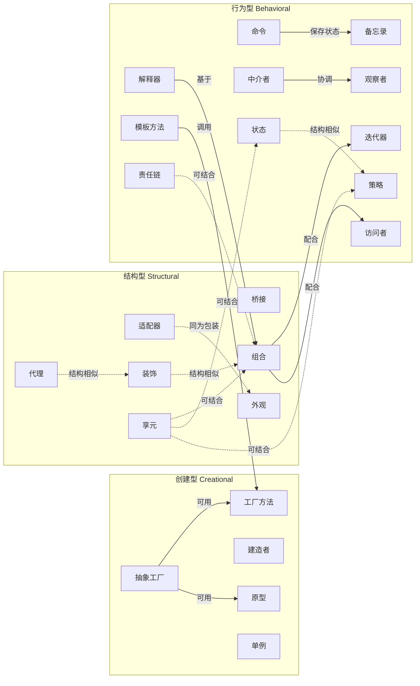

# 🧩 23 种设计模式（Java 版）

[English](README.md) | 简体中文

GoF《设计模式》23 种设计模式的 Java 实现与学习项目：每个模式都配有文档、可运行案例和图形化界面，适合系统性地学习和复习设计模式。

[](LICENSE)
[](https://openjdk.org/)
[](https://maven.apache.org/)

## 项目简介

本项目基于 **Java 21** 与 **Maven** 构建，完整覆盖 GoF（《设计模式》）中的 23 种设计模式。每个模式都提供了：

- **模式文档**：从「意图 → 问题 → 解决方案 → 结构 → 效果」系统讲解，并配以 Mermaid 结构图；
- **可运行案例**：贴近真实场景的示例代码，可在图形界面中一键运行、观察输出；
- **图形化界面**：左侧案例树、右侧文档与输出区，点击即可阅读文档、运行示例；
- **国际化支持**：界面文案、案例输出与文档均按国际化架构组织，可平滑扩展更多语言。

## 项目结构

```
design-patternz/                              # Maven 项目（Java 21）
├── pom.xml                                   # 构建配置
└── src/main/java/com/zhuzz/design/
    ├── lab/                                  # 框架层：图形界面、国际化、文档渲染、案例自动发现
    └── patternz/                             # 案例层：23 种设计模式，每个模式一个子包
```

- `lab`：通用框架，负责图形界面、国际化、文档渲染与案例自动发现，与具体模式解耦；
- `patternz`：23 种设计模式的案例，每个模式一个子包，案例由框架自动扫描发现，无需手动注册。

## 快速开始

### 环境要求

- JDK 21（`JAVA_HOME` 指向 JDK 21）
- 无需预装 Maven：项目自带 Maven Wrapper

### 构建

```bash
# Windows
.\mvnw.cmd clean compile

# Linux / macOS
./mvnw clean compile
```

### 运行

方式一（推荐）：用 IDE 打开项目，运行 `com.zhuzz.design.lab.Launcher` 的 `main` 方法。

方式二（命令行，首次需联网下载 exec 插件）：

```bash
./mvnw org.codehaus.mojo:exec-maven-plugin:3.1.0:java \
  -Dexec.mainClass=com.zhuzz.design.lab.Launcher
```

方式三（不启动 GUI，直接运行单个案例）：

在 IDEA 中打开任意 `*Demo` 类，点击类名旁的绿色运行按钮即可直接运行（也可在 Run Configuration 的 Program arguments 中填入参数，如 `--op=Multiplication --a=6 --b=7`）。

也可在命令行运行：

```bash
# 先编译
.\mvnw.cmd clean compile

# 通过全限定类名运行任意案例
java -cp target/classes com.zhuzz.design.patternz.decorator.datastream.DataStreamDemo

# 通过 --key=value 或 --key value 传入输入项，未传入的使用默认值
java -cp target/classes com.zhuzz.design.patternz.strategy.calculator.CalculatorDemo --op=Multiplication --a=6 --b=7

# 切换输出语言（en / zh）
java -cp target/classes com.zhuzz.design.patternz.strategy.calculator.CalculatorDemo --op=Subtraction --a=10 --b=3 --lang=en

# 查看该案例支持的输入项与可选值
java -cp target/classes com.zhuzz.design.patternz.strategy.payment.PaymentDemo --help
```

每个 `*Demo` 类都继承自 `com.zhuzz.design.lab.DemoSupport`，由该基类提供统一的 `main` 方法，因此任意案例都可通过 `java <全限定类名>` 直接独立运行。

### 界面使用

- **左侧案例树**：按「创建型 / 结构型 / 行为型」分组，逐级展开到模式与案例；
- **点击模式节点**：右侧展示该模式的文档（含 Mermaid 结构图）；
- **点击案例节点**：展示案例文档，可点击「运行」按钮执行示例、观察输出；
- **顶部工具栏**：可切换界面语言、清空输出。

## 什么是设计模式

设计模式是在软件设计中反复出现的问题的通用解决方案。它们是经过多次验证和应用的指导原则，旨在帮助软件开发人员解决特定类型的问题，提高代码的可维护性、可扩展性和重用性。

设计模式是一种抽象化的思维方式，可以帮助开发人员更好地组织和设计他们的代码。它们提供了一种通用的框架，可以用于解决各种不同的软件设计问题。设计模式不是完整的代码，而是一种描述问题和解决方案之间关系的模板。

设计模式并不是一成不变的法则，而是根据不同的问题和情境来决定是否使用以及如何使用。了解和应用设计模式可以帮助开发人员更好地组织代码，提高代码的可读性和可维护性，同时也有助于促进团队之间的合作和沟通。

## 为什么在 AI 时代还要学设计模式

如今大模型辅助编程越来越普及，很多「写代码」的工作可以交给 AI 完成，但这反而让设计模式更有价值：

- **它是与 AI 高效协作的「共同语言」**：当你需要 AI 生成、重构或评审一段代码时，能否用「工厂方法」「观察者」这样的术语精确描述诉求，直接决定了产出质量。看懂、评价并修改 AI 生成的代码，同样依赖这些概念。
- **它教的是「决策」而非「编码」**：AI 能写出某种模式的代码，但「该不该用、用哪个、如何权衡利弊」仍需人来判断。设计模式的核心价值恰恰在于分析问题、做取舍的能力，这是 AI 无法替你完成的。
- **它培养可迁移的结构化思维**：设计模式本质上是把问题抽象、解耦、分层的一套思维方法。这种能力不随工具升级而过时，反而在 AI 时代成为更稀缺的竞争力。
- **它是阅读开源项目与协作的通行证**：大量主流框架（如 Spring、Guava、JDK 本身）都是设计模式的「活教材」，读懂它们的源码、参与社区协作，都离不开设计模式。

## 设计模式的分类

设计模式通常按目的分为三大类：

1. **创建型模式（Creational）**：关注对象的实例化过程，包括如何实例化对象、隐藏对象的创建细节等。常见的创建型模式有单例模式、工厂方法模式、抽象工厂模式等。
2. **结构型模式（Structural）**：关注对象之间的组合方式，以达到构建更大结构的目标。这些模式帮助你定义对象之间的关系，从而实现更大的结构。常见的结构型模式有适配器模式、装饰器模式、代理模式等。
3. **行为型模式（Behavioral）**：关注对象之间的通信方式，以及如何合作共同完成任务。这些模式涉及对象之间的交互、责任分配等。常见的行为型模式有观察者模式、策略模式、命令模式等。

## 设计模式的基本要素

每个设计模式都包含四个基本要素，本项目每个模式的文档也正是按此组织：

1. **模式名称**：每个设计模式都有一个简洁的名称，用于描述问题、解决方案和效果。这个名称有助于在交流中快速指代模式。
2. **问题**：描述了在什么情况下应该考虑使用特定的设计模式。问题部分阐述了该模式试图解决的具体设计难题。
3. **解决方案**：解决方案部分提供了一个详细的设计指南，描述了如何组织类、对象以及它们之间的关系，以解决特定问题。这包括每个角色的职责、协作方式等。
4. **效果**：描述了模式应用的效果及使用模式应权衡的问题。

## 23 种设计模式概览

### 创建型模式（5 个）

| 模式 | 意图 |
| --- | --- |
| [工厂方法 Factory Method](design-patternz/src/main/java/com/zhuzz/design/patternz/factorymethod/README_zh.md) | 定义创建对象的接口，由子类决定实例化哪个类 |
| [抽象工厂 Abstract Factory](design-patternz/src/main/java/com/zhuzz/design/patternz/abstractfactory/README_zh.md) | 提供创建一系列相关对象的接口，无需指定具体类 |
| [建造者 Builder](design-patternz/src/main/java/com/zhuzz/design/patternz/builder/README_zh.md) | 将复杂对象的构建与其表示分离 |
| [原型 Prototype](design-patternz/src/main/java/com/zhuzz/design/patternz/prototype/README_zh.md) | 通过复制已有实例来创建新对象 |
| [单例 Singleton](design-patternz/src/main/java/com/zhuzz/design/patternz/singleton/README_zh.md) | 保证一个类只有一个实例，并提供全局访问点 |

### 结构型模式（7 个）

| 模式 | 意图 |
| --- | --- |
| [适配器 Adapter](design-patternz/src/main/java/com/zhuzz/design/patternz/adapter/README_zh.md) | 将类的接口转换成客户端期望的另一个接口 |
| [桥接 Bridge](design-patternz/src/main/java/com/zhuzz/design/patternz/bridge/README_zh.md) | 将抽象与实现分离，使两者可独立变化 |
| [组合 Composite](design-patternz/src/main/java/com/zhuzz/design/patternz/composite/README_zh.md) | 将对象组合成树形结构以表示「部分-整体」层次 |
| [装饰 Decorator](design-patternz/src/main/java/com/zhuzz/design/patternz/decorator/README_zh.md) | 动态地给对象添加额外职责 |
| [外观 Facade](design-patternz/src/main/java/com/zhuzz/design/patternz/facade/README_zh.md) | 为子系统提供统一的高层接口 |
| [享元 Flyweight](design-patternz/src/main/java/com/zhuzz/design/patternz/flyweight/README_zh.md) | 共享大量细粒度对象以节省内存 |
| [代理 Proxy](design-patternz/src/main/java/com/zhuzz/design/patternz/proxy/README_zh.md) | 为其他对象提供代理以控制对其的访问 |

### 行为型模式（11 个）

| 模式 | 意图 |
| --- | --- |
| [解释器 Interpreter](design-patternz/src/main/java/com/zhuzz/design/patternz/interpreter/README_zh.md) | 为语言定义文法并解释句子 |
| [模板方法 Template Method](design-patternz/src/main/java/com/zhuzz/design/patternz/templatemethod/README_zh.md) | 定义算法骨架，将某些步骤延迟到子类 |
| [责任链 Chain of Responsibility](design-patternz/src/main/java/com/zhuzz/design/patternz/chainofresponsibility/README_zh.md) | 使多个对象都有机会处理请求，避免发送者与接收者耦合 |
| [命令 Command](design-patternz/src/main/java/com/zhuzz/design/patternz/command/README_zh.md) | 将请求封装为对象，支持参数化、日志与撤销 |
| [迭代器 Iterator](design-patternz/src/main/java/com/zhuzz/design/patternz/iterator/README_zh.md) | 顺序访问集合元素，而不暴露其内部表示 |
| [中介者 Mediator](design-patternz/src/main/java/com/zhuzz/design/patternz/mediator/README_zh.md) | 用一个中介对象封装一组对象之间的交互 |
| [备忘录 Memento](design-patternz/src/main/java/com/zhuzz/design/patternz/memento/README_zh.md) | 在不破坏封装的前提下捕获并恢复对象状态 |
| [观察者 Observer](design-patternz/src/main/java/com/zhuzz/design/patternz/observer/README_zh.md) | 定义一对多的依赖，对象状态改变时通知所有依赖者 |
| [状态 State](design-patternz/src/main/java/com/zhuzz/design/patternz/state/README_zh.md) | 允许对象在其内部状态改变时改变行为 |
| [策略 Strategy](design-patternz/src/main/java/com/zhuzz/design/patternz/strategy/README_zh.md) | 定义一系列算法，使其可相互替换 |
| [访问者 Visitor](design-patternz/src/main/java/com/zhuzz/design/patternz/visitor/README_zh.md) | 在不改变元素类的前提下，对其定义新的操作 |

## 设计模式间的关系

23 种设计模式并非孤立存在，它们之间存在引用、组合与相似等关系。下图按三大分类聚类，用实线表示「引用 / 组合」，虚线表示「结构相似 / 可结合」：



## 参与贡献

欢迎参与本项目，一起把它做得更好！详细的贡献方式请参阅 [CONTRIBUTING.md](CONTRIBUTING.md)。

如果这个项目对你有帮助，欢迎点一个 Star ⭐。

## 联系方式

有任何问题、建议或想法，欢迎联系：[zhuzz1994@gmail.com](mailto:zhuzz1994@gmail.com)。