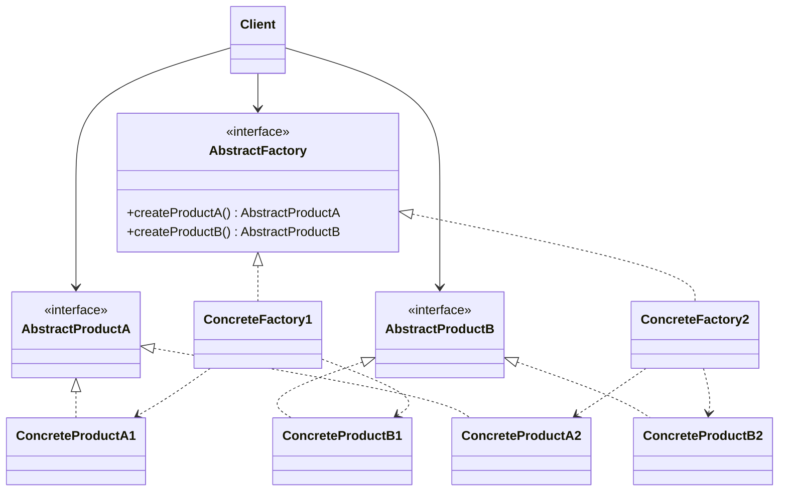

# Abstract Factory Pattern

> Provides an interface for creating families of related or dependent objects without specifying their concrete classes.

## Intent

Abstract Factory is a **creational** design pattern. It hides the responsibility of "creating a family of related objects" behind an interface, so clients program only against the abstract factory and obtain a coherent set of products without knowing their concrete classes.

## Problem

Sometimes a system must create a series of related or interdependent objects that belong to one **product family**, while guaranteeing consistency across that family. Creating them directly couples the code to concrete product details and hurts extension and maintenance. For example, a cross-platform UI library must produce a "button + text field" pair, with separate implementations for Windows and macOS; clients should not call `new WindowsButton()` directly.

## Solution

The Abstract Factory pattern separates object creation from clients through an abstract factory interface and its concrete implementations. A client holds a reference to the abstract factory and requests products from it; which family is actually produced is determined by the factory injected at runtime.

| Role | Description |
|------|-------------|
| Abstract factory | Declares the creation methods for the various products |
| Concrete factory | Implements the abstract factory and creates objects of a **specific product family** |
| Abstract product | Defines the common interface for one kind of product |
| Concrete product | Implements an abstract product interface and is the actual object created |

## Structure

- **AbstractFactory**: declares the creation methods for the abstract products; clients depend only on it.
- **ConcreteFactory**: implements the abstract factory; the products it yields belong to one family (e.g. `ConcreteFactory1` produces `A1 + B1`).
- **AbstractProduct**: the unified interface for each kind of product, hiding differences between families.
- **ConcreteProduct**: the concrete implementation of an abstract product, appearing in pairs per family.
- **Client**: programs only against the abstract factory and abstract products, never coupling to concrete classes.

## Effects

**Pros**

- **Family consistency**: guarantees that the created products belong to one coherent family.
- **Loose coupling**: clients depend only on the abstract factory interface, not on concrete products.
- **Extensibility**: new families are added via new factory and product classes, without touching existing code.

**Cons**

- **Increased complexity**: every product family needs a corresponding concrete factory, so the number of classes grows with the families.

**When to use**

- When you need to create a series of related products and guarantee their consistency.
- When the same set of products must switch implementations across environments (OS, theme, brand).

## Cases in this project

- [Office Suite](officesuite/README.md) — builds a word processor, spreadsheet and presentation using an abstract factory.
- [UI Toolkit](uitoolkit/README.md) — produces style-consistent buttons and text fields for different platforms.