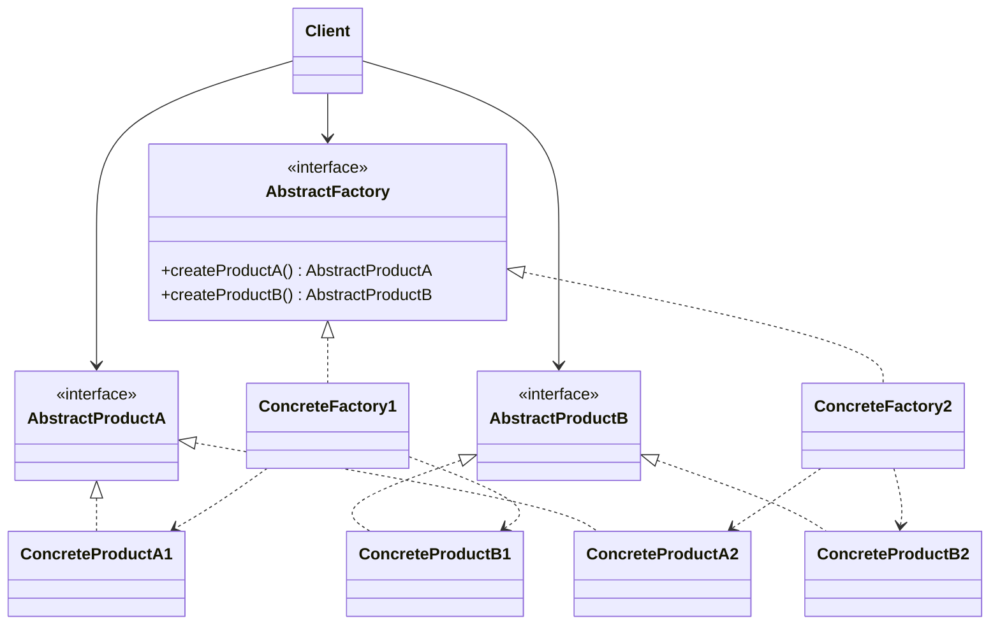

# 抽象工厂模式（Abstract Factory）

> 提供一个接口，用于创建一系列相关或相互依赖的对象，而无需指定它们的具体类。

## 意图

抽象工厂模式（Abstract Factory）是一种**创建型**设计模式。它把「创建一系列相关对象」的职责封装在一个接口之后，让客户端只面向抽象工厂编程，就能一次获得一组彼此配套的产品，而不必关心这些产品具体是哪个类。

## 问题

有些时候需要创建一系列相关或相互依赖的对象，这些对象同属一个**产品族**，系统还需保证产品族之间的一致性。若在代码中直接创建这些对象，会让代码与具体产品细节紧密耦合，不利于后续扩展与维护。例如一个跨平台 UI 库要同时产出「按钮 + 文本框」这套组件，Windows 与 macOS 各有各的实现，客户端不应该直接 `new WindowsButton()` 这类具体类。

## 解决方案

抽象工厂模式通过抽象工厂接口及其具体实现，把对象的创建与客户端分离，从而实现松耦合。客户端只需要持有抽象工厂的引用，向它索取产品，具体是哪个产品族则由运行时注入的工厂决定。

| 角色 | 说明 |
|------|------|
| 抽象工厂 | 声明一组用于创建不同产品的抽象方法 |
| 具体工厂 | 实现抽象工厂，负责创建**特定产品族**的对象 |
| 抽象产品 | 定义某一类产品的通用接口 |
| 具体产品 | 实现抽象产品接口，是抽象工厂实际创建的对象 |

## 结构

- **抽象工厂（AbstractFactory）**：声明创建各抽象产品的方法，客户端只依赖它。
- **具体工厂（ConcreteFactory）**：实现抽象工厂，产出的具体产品同属一个产品族（如 `ConcreteFactory1` 产出 `A1 + B1`）。
- **抽象产品（AbstractProduct）**：每种产品的统一接口，屏蔽不同产品族之间的差异。
- **具体产品（ConcreteProduct）**：抽象产品的具体实现，按产品族成对出现。
- **客户端（Client）**：只面向抽象工厂与抽象产品编程，不与任何具体类耦合。

## 效果

**优点**

- **产品族一致性**：抽象工厂保证创建的产品同属一组相关产品族，彼此一致。
- **松耦合**：客户端只依赖抽象工厂接口，不依赖具体产品。
- **可扩展性**：新增产品族只需添加新的具体工厂与产品类，无需改动现有代码。

**缺点**

- **复杂度上升**：每个产品族都必须有一个对应的具体工厂，类数量会随产品族增加。

**适用场景**

- 需要创建一系列相关产品并保证它们之间一致性的场景。
- 同一套产品需要在不同环境（操作系统、主题、品牌）下切换实现的场景。

## 项目中的案例

- [办公套件](officesuite/README_zh.md) —— 用抽象工厂创建 Word、电子表格、演示文稿三件套。
- [跨平台 UI 组件](uitoolkit/README_zh.md) —— 用抽象工厂为不同平台生成风格一致的按钮与文本框。