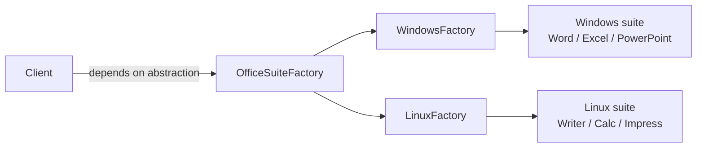
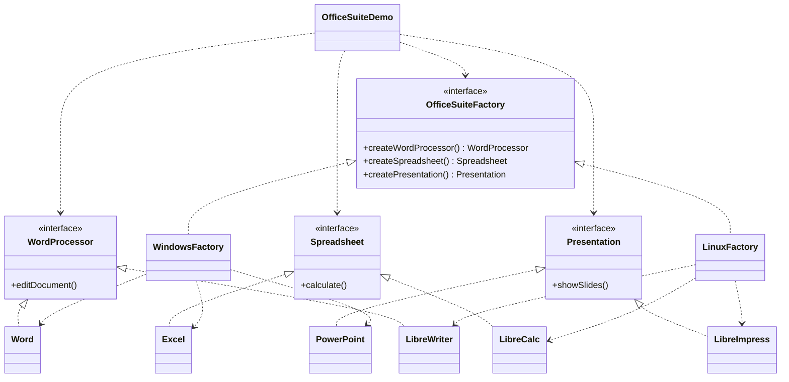

# Office Suite — Abstract Factory

> Builds a complete office suite (word processor, spreadsheet, presentation)
> for a target platform, and switches the whole suite by swapping one factory.

## Big Picture

## Scenario

Imagine an application that must deliver a *complete* office bundle. On Windows
it ships Microsoft Office (Word, Excel, PowerPoint); on Linux it ships
LibreOffice (Writer, Calc, Impress). The client does not care which platform it
is on — it asks an abstract factory for a word processor, a spreadsheet and a
presentation, and gets back a consistent set.

## Design Pattern

**Abstract Factory** — provides an interface for creating families of related
objects without specifying their concrete classes.

Why it fits:

- There are **3 abstract products** (`WordProcessor`, `Spreadsheet`, `Presentation`).
- There are **2 product families** (Windows, Linux), each implementing all 3.
- The client depends only on `OfficeSuiteFactory`; swapping the factory swaps
  the entire family.

## Structure

| Role | Participants |
|------|--------------|
| Abstract products | `WordProcessor`, `Spreadsheet`, `Presentation` |
| Concrete products (Windows) | `Word`, `Excel`, `PowerPoint` |
| Concrete products (Linux) | `LibreWriter`, `LibreCalc`, `LibreImpress` |
| Abstract factory | `OfficeSuiteFactory` |
| Concrete factories | `WindowsFactory`, `LinuxFactory` |
| Client / demo | `OfficeSuiteDemo` |

## Design Rationale

- All three products stay on the **same conceptual level** (application
  software), so the family is consistent and easy to grasp.
- The factory name matches the scenario name, avoiding the confusion of mixing
  operating systems into the product family.
- One file per type, following the Java convention, keeps each role readable.