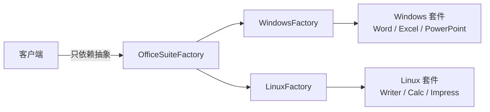
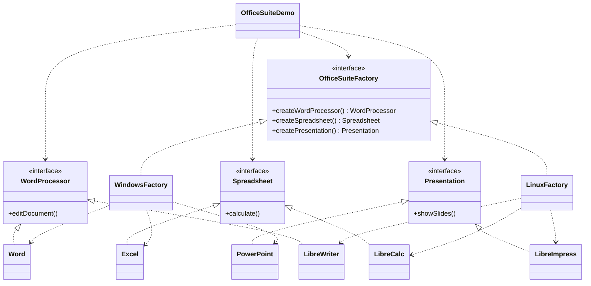

# 办公套件 — 抽象工厂

> 为目标平台构建一整套办公套件（文字处理、电子表格、演示文稿），
> 只需替换一个工厂即可整体切换整套软件。

## 整体概览

## 场景描述

设想一个应用需要交付一整套办公软件：Windows 上交付 Microsoft Office（Word、
Excel、PowerPoint），Linux 上交付 LibreOffice（Writer、Calc、Impress）。客户端
无需关心平台——只向抽象工厂索取文字处理器、电子表格和演示文稿，就能得到一套
彼此配套的产品。

## 设计模式

**抽象工厂** —— 提供创建一系列相关对象族的接口，而无需指定具体类。

为什么匹配：

- 存在 **3 个抽象产品**（`WordProcessor`、`Spreadsheet`、`Presentation`）。
- 存在 **2 个产品族**（Windows、Linux），每族都实现了全部 3 个产品。
- 客户端只依赖 `OfficeSuiteFactory`；替换工厂即可整体切换产品族。

## 结构

| 角色 | 参与者 |
|------|--------|
| 抽象产品 | `WordProcessor`、`Spreadsheet`、`Presentation` |
| 具体产品（Windows） | `Word`、`Excel`、`PowerPoint` |
| 具体产品（Linux） | `LibreWriter`、`LibreCalc`、`LibreImpress` |
| 抽象工厂 | `OfficeSuiteFactory` |
| 具体工厂 | `WindowsFactory`、`LinuxFactory` |
| 客户端 / 演示 | `OfficeSuiteDemo` |

## 设计理念

- 三个产品都处于**同一概念层级**（应用软件），产品族保持一致、易于理解。
- 工厂名与案例名一致（"办公套件"），避免把操作系统混入产品族造成困惑。
- 遵循 Java 惯例一个类型一个文件，让每个角色都清晰可读。