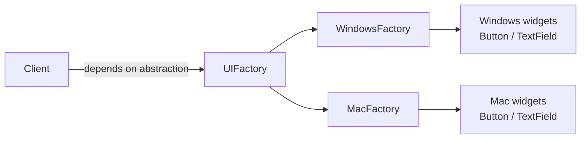
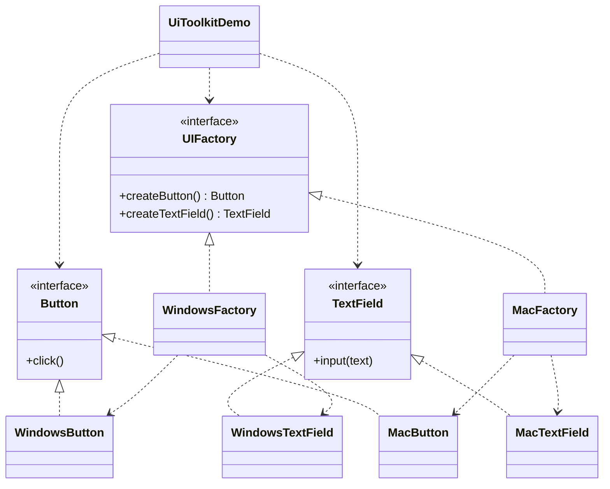

# UI Toolkit — Abstract Factory

> Produces a consistent set of UI widgets (button, text field) for a target
> platform, and switches the whole look by swapping one factory.

## Big Picture

## Scenario

A cross-platform GUI library must render the same kinds of widgets — buttons and
text fields — in the native style of each platform. On Windows it uses
Windows-style widgets; on macOS it uses the Mac look. The application code only
asks a factory for "a button" and "a text field", never for a concrete widget
class.

## Design Pattern

**Abstract Factory** — provides an interface for creating families of related
objects without specifying their concrete classes.

Why it fits:

- There are **2 abstract products** (`Button`, `TextField`).
- There are **2 product families** (Windows, Mac), each implementing both.
- The client depends only on `UIFactory`; swapping the factory swaps the entire
  widget family.

## Structure

| Role | Participants |
|------|--------------|
| Abstract products | `Button`, `TextField` |
| Concrete products (Windows) | `WindowsButton`, `WindowsTextField` |
| Concrete products (Mac) | `MacButton`, `MacTextField` |
| Abstract factory | `UIFactory` |
| Concrete factories | `WindowsFactory`, `MacFactory` |
| Client / demo | `UiToolkitDemo` |

## Design Rationale

- Both products stay on the **same conceptual level** (UI widgets), so the
  family is consistent and easy to grasp.
- This is the classic "cross-platform GUI" scenario, the most canonical example
  of Abstract Factory.
- One file per type, following the Java convention, keeps each role readable.