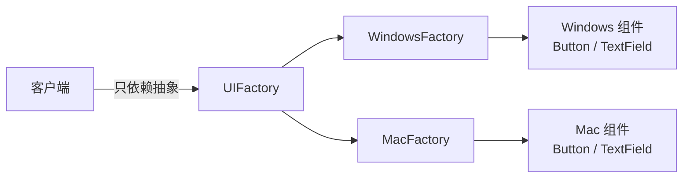
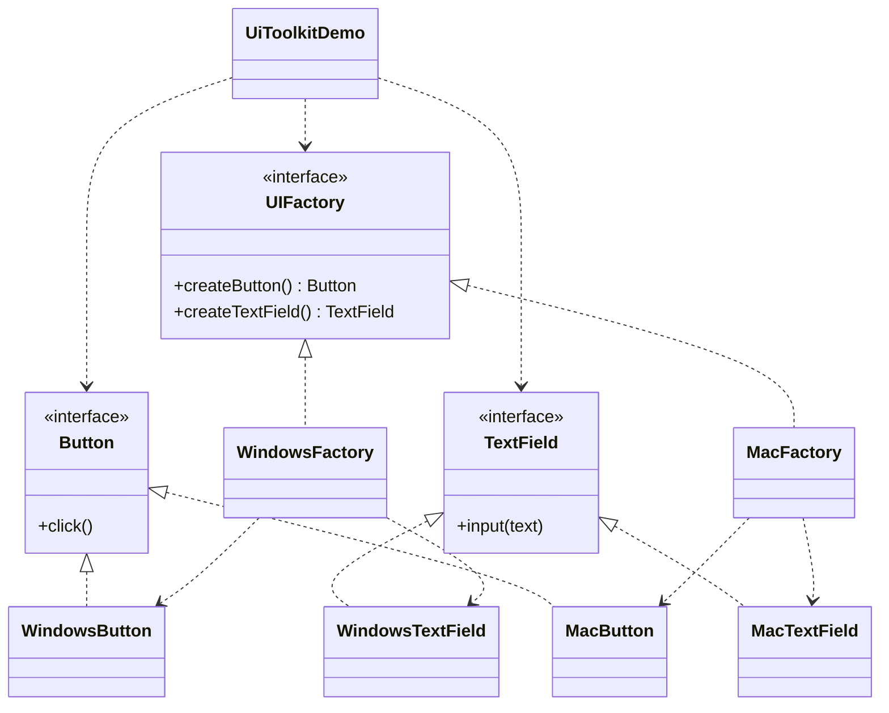

# 跨平台 UI 组件 — 抽象工厂

> 为目标平台生成一套风格一致的 UI 组件（按钮、文本框），
> 只需替换一个工厂即可整体切换整套外观。

## 整体概览

## 场景描述

一个跨平台 GUI 库需要在各平台渲染同一类组件——按钮和文本框——但外观要贴合
各平台的原生风格：Windows 上使用 Windows 风格，macOS 上使用 Mac 风格。应用
代码只向工厂索取"一个按钮"和"一个文本框"，从不接触具体的组件类。

## 设计模式

**抽象工厂** —— 提供创建一系列相关对象族的接口，而无需指定具体类。

为什么匹配：

- 存在 **2 个抽象产品**（`Button`、`TextField`）。
- 存在 **2 个产品族**（Windows、Mac），每族都实现了两个产品。
- 客户端只依赖 `UIFactory`；替换工厂即可整体切换组件族。

## 结构

| 角色 | 参与者 |
|------|--------|
| 抽象产品 | `Button`、`TextField` |
| 具体产品（Windows） | `WindowsButton`、`WindowsTextField` |
| 具体产品（Mac） | `MacButton`、`MacTextField` |
| 抽象工厂 | `UIFactory` |
| 具体工厂 | `WindowsFactory`、`MacFactory` |
| 客户端 / 演示 | `UiToolkitDemo` |

## 设计理念

- 两个产品都处于**同一概念层级**（UI 组件），产品族保持一致、易于理解。
- 这是"跨平台 GUI"的经典场景，是抽象工厂最典范的例子。
- 遵循 Java 惯例一个类型一个文件，让每个角色都清晰可读。