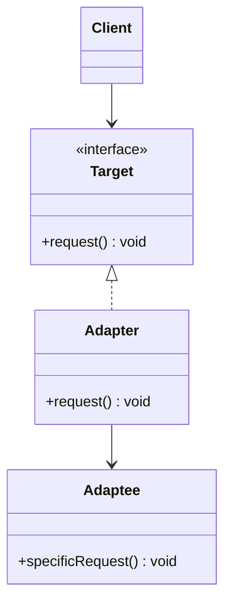

# Adapter Pattern

> Converts the interface of a class into another interface clients expect, letting classes work together that otherwise could not because of incompatible interfaces.

## Intent

Adapter is a **structural** design pattern. It introduces an adapter between two incompatible interfaces, acting as a middleman to convert one interface into another so classes that otherwise could not work together can cooperate.

## Problem

When two classes (or objects) have incompatible interfaces but must work together, they cannot be wired directly. For example, an existing library or component has an interface that does not match your code, yet you need to integrate it seamlessly.

## Solution

Adapter introduces an adapter class as a middleman to convert interface A into interface B. The adapter holds a reference to the incompatible interface and implements the target interface, delegating target method calls to the adapted object.

| Role | Description |
|------|-------------|
| Target | The interface clients expect |
| Adapter | Implements the target interface and forwards calls to the adaptee |
| Adaptee | An existing class with an incompatible interface |
| Client | Interacts with the adapter through the target interface |

## Structure

- **Target**: the interface clients expect.
- **Adapter**: implements the target interface, holds an adaptee reference, and turns `request()` into `specificRequest()`.
- **Adaptee**: an existing class with an incompatible interface.
- **Client**: depends only on the target interface.

## Effects

**Pros**

- **Better reuse**: existing and new code work together without large-scale changes.
- **Flexible integration**: different systems, libraries or components can be combined.

**Cons**

- **Added complexity**: the adapter must be maintained, and mappings between interfaces must be handled.

**When to use**

- When integrating different components or classes and resolving interface mismatches.

## Cases in this project

- [Media Player](mediaplayer/README.md) — uses an adapter to let a player handle different media formats.
- [Rectangle Adapter](rectangleadapter/README.md) — adapts a legacy rectangle class to a unified shape interface.