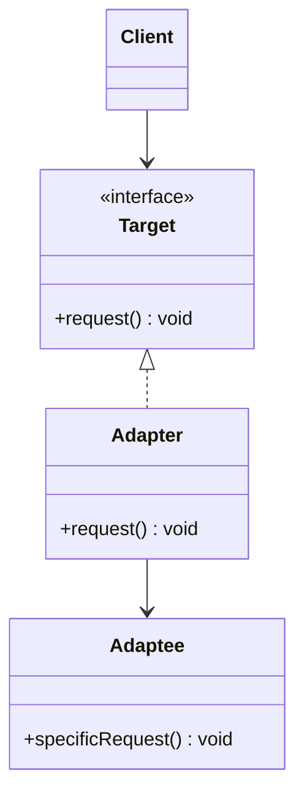

# 适配器模式（Adapter）

> 将一个类的接口转换成客户希望的另一个接口，使得原本由于接口不兼容而不能一起工作的类可以协同工作。

## 意图

适配器模式（Adapter）是一种**结构型**设计模式。它在两个不兼容的接口之间引入一个适配器，充当中间人，把一个接口转换成另一个接口，使原本无法一起工作的类能够协同运行。

## 问题

当两个类（或对象）的接口不兼容、却需要它们一起工作时，直接对接无法实现。例如已存在的类库或组件与当前代码的接口不匹配，需要无缝集成。

## 解决方案

适配器模式通过适配器类充当中间人，将接口 A 转换成接口 B。适配器类持有对不兼容接口的引用，并实现目标接口，在目标方法内部调用被适配对象的方法。

| 角色 | 说明 |
|------|------|
| 目标接口 | 客户端期望使用的接口 |
| 适配器 | 实现目标接口，并把调用转接到被适配对象 |
| 被适配者 | 已存在、接口不兼容的类 |
| 客户端 | 通过目标接口与适配器交互 |

## 结构

- **目标接口（Target）**：客户端期望的接口。
- **适配器（Adapter）**：实现目标接口，内部持有被适配者引用，把 `request()` 转成 `specificRequest()`。
- **被适配者（Adaptee）**：已存在的、接口不兼容的类。
- **客户端（Client）**：只依赖目标接口。

## 效果

**优点**

- **提高复用性**：让现有代码与新代码无缝协同，无需大量修改。
- **灵活集成**：能把不同系统、库或组件整合在一起。

**缺点**

- **增加复杂性**：需要维护适配器类，并处理不同接口之间的映射关系。

**适用场景**

- 集成不同组件或类、解决接口不匹配的场景。

## 项目中的案例

- [媒体播放器](mediaplayer/README_zh.md) —— 用适配器让播放器兼容不同格式的媒体。
- [矩形适配](rectangleadapter/README_zh.md) —— 用适配器把旧矩形类适配到统一图形接口。