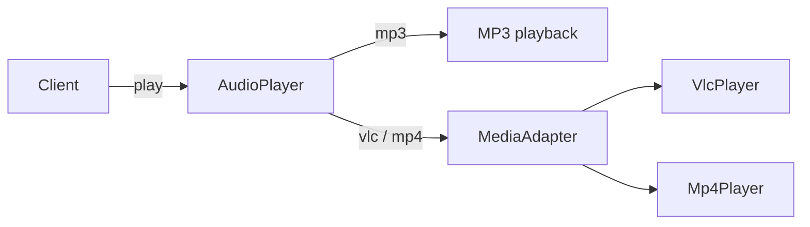
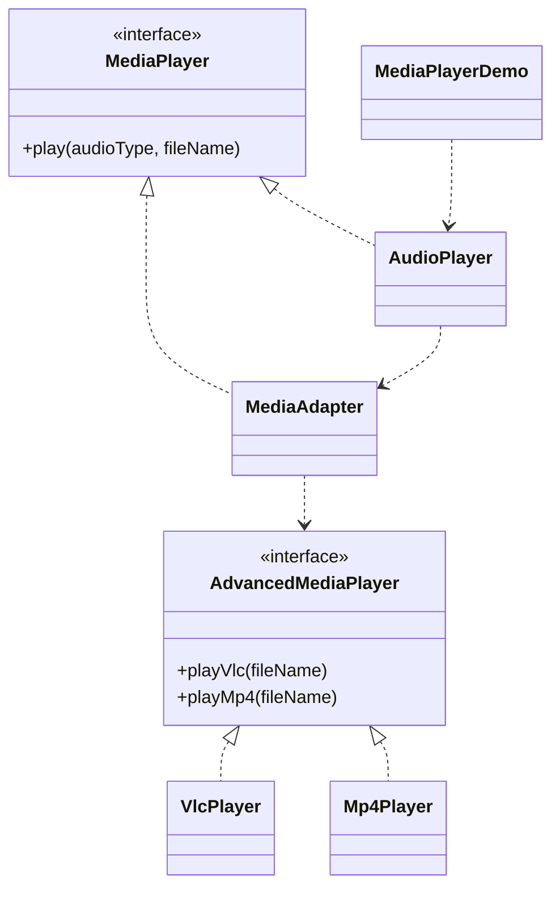

# Media Player — Adapter

> Lets a player that only knows MP3 also play VLC and MP4 by wrapping the
> advanced players behind a shared interface.

## Big Picture

## Scenario

An audio player supports MP3 out of the box. To also play VLC and MP4, it
should not rewrite its own interface for every format. Instead, a
`MediaAdapter` bridges the gap: the client keeps calling `play(type, file)`,
and the adapter routes the call to the right advanced player.

## Design Pattern

**Adapter** — converts the interface of a class into another interface the
client expects.

Why it fits:

- The client expects one interface (`MediaPlayer`).
- The advanced players expose a different interface (`AdvancedMediaPlayer`).
- `MediaAdapter` translates between them without changing either side.

## Structure

| Role | Participants |
|------|--------------|
| Target | `MediaPlayer` |
| Adapter | `MediaAdapter` |
| Adaptee | `AdvancedMediaPlayer`, `VlcPlayer`, `Mp4Player` |
| Client | `AudioPlayer`, `MediaPlayerDemo` |

## Design Rationale

- The classic media-player scenario clearly shows "reusing an existing class
  with an incompatible interface".
- It complements "Rectangle Adapter" by adapting to a different target shape
  (playback vs. drawing), covering the same idea from another angle.
- One file per type, following the Java convention, keeps each role readable.