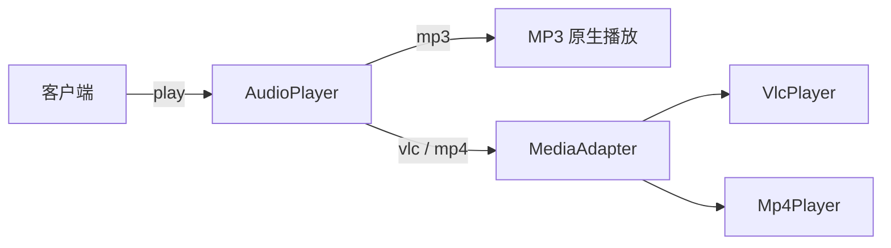
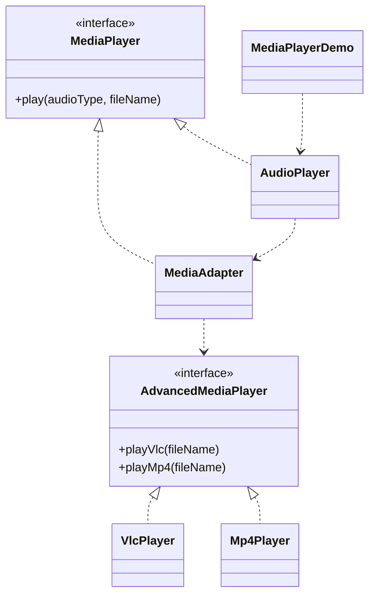

# 媒体播放器 — 适配器

> 让原本只认 MP3 的播放器也能播放 VLC 和 MP4，把高级播放器包装到统一的接口后面。

## 整体概览

## 场景描述

一个音频播放器原生支持 MP3。为了也能播放 VLC 和 MP4，它不该为每种格式重写自己的
接口。于是引入 `MediaAdapter` 来弥合差异：客户端仍调用 `play(type, file)`，
适配器把调用转发给对应的高级播放器。

## 设计模式

**适配器** —— 把一个类的接口转换成客户端期望的另一个接口。

为什么匹配：

- 客户端期望的是同一个接口（`MediaPlayer`）。
- 高级播放器暴露的是不同接口（`AdvancedMediaPlayer`）。
- `MediaAdapter` 在两者之间做转换，且不修改任何一方。

## 结构

| 角色 | 参与者 |
|------|--------|
| 目标接口 | `MediaPlayer` |
| 适配器 | `MediaAdapter` |
| 被适配者 | `AdvancedMediaPlayer`、`VlcPlayer`、`Mp4Player` |
| 客户端 | `AudioPlayer`、`MediaPlayerDemo` |

## 设计理念

- 经典的媒体播放器场景直观展示了"复用一个接口不兼容的既有类"。
- 与"矩形适配"互补：目标形态从绘图换成播放，从另一角度覆盖同一思想。
- 遵循 Java 惯例一个类型一个文件，让每个角色都清晰可读。