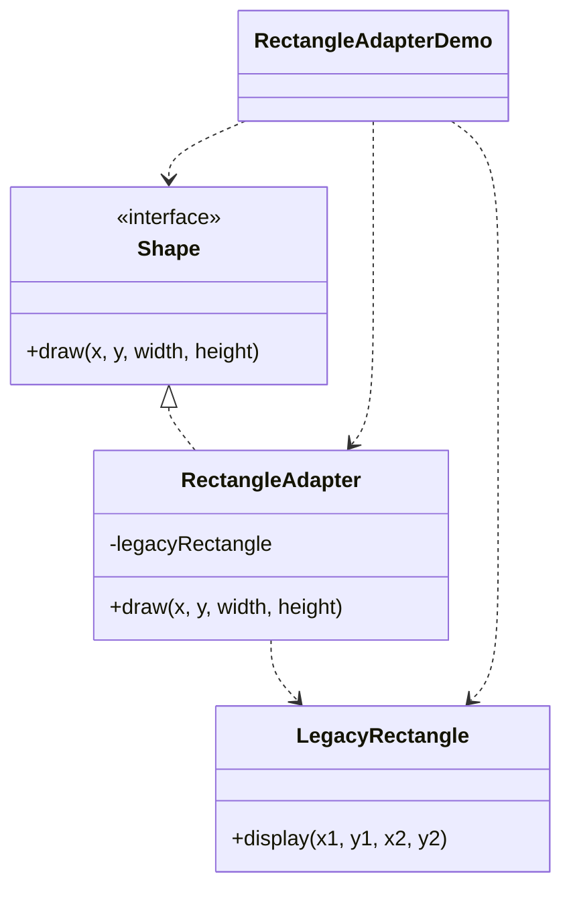

# Rectangle Adapter — Adapter

> Adapts a legacy rectangle (two-point coordinates) to the client's `Shape`
> interface (x, y, width, height), letting old code serve new callers.

## Big Picture

## Scenario

A client draws shapes through a `Shape` interface that takes a top-left corner
plus width and height. There is an existing `LegacyRectangle` that only draws
from two corner points. We do not want to rewrite the legacy class, so an
adapter translates the new-style call into the old-style call.

## Design Pattern

**Adapter** — converts the interface of a class into another interface the
client expects.

Why it fits:

- There is a **target interface** (`Shape`) that the client depends on.
- There is an **adaptee** (`LegacyRectangle`) with an incompatible method
  signature (`display(x1, y1, x2, y2)`).
- `RectangleAdapter` implements the target interface and converts coordinates,
  wrapping the adaptee instead of modifying it.

## Structure

| Role | Participants |
|------|--------------|
| Target | `Shape` |
| Adaptee | `LegacyRectangle` |
| Adapter | `RectangleAdapter` |
| Client / demo | `RectangleAdapterDemo` |

## Design Rationale

- The adapter converts "corner + size" into "two points" with a trivial
  `x2 = x + width` calculation, keeping the example focused on interface
  adaptation rather than business logic.
- The legacy class stays untouched, which is the whole point of the pattern.
- One file per type keeps the three roles easy to tell apart.