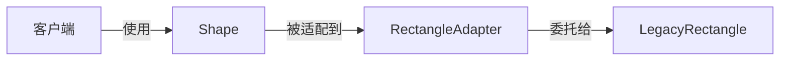
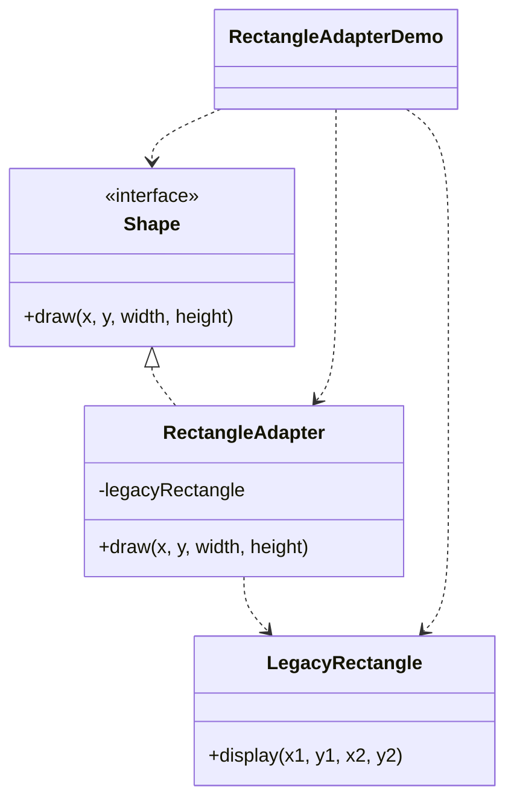

# 矩形适配 — 适配器

> 把一个旧矩形（两点坐标）适配到客户端的 `Shape` 接口（x、y、宽、高），
> 让旧代码无需修改即可服务新调用方。

## 整体概览

## 场景描述

客户端通过 `Shape` 接口绘制图形，该接口接收左上角坐标加宽高。现有一个
`LegacyRectangle` 只能按两个角点绘制。我们不想改写旧类，于是用一个适配器把
新式调用翻译成旧式调用。

## 设计模式

**适配器** —— 将一个类的接口转换成客户端期望的另一种接口。

为什么匹配：

- 存在客户端依赖的**目标接口**（`Shape`）。
- 存在方法签名不兼容的**适配者**（`LegacyRectangle` 的 `display(x1, y1, x2, y2)`）。
- `RectangleAdapter` 实现目标接口并完成坐标换算，包装适配者而非修改它。

## 结构

| 角色 | 参与者 |
|------|--------|
| 目标接口 | `Shape` |
| 适配者 | `LegacyRectangle` |
| 适配器 | `RectangleAdapter` |
| 客户端 / 演示 | `RectangleAdapterDemo` |

## 设计理念

- 适配器用一次简单的 `x2 = x + width` 完成「角点 + 尺寸」到「两点」的换算，
  让案例聚焦于接口适配而非业务逻辑。
- 旧类保持原封不动，这正是适配器模式的核心价值。
- 一个类型一个文件，三种角色一目了然。