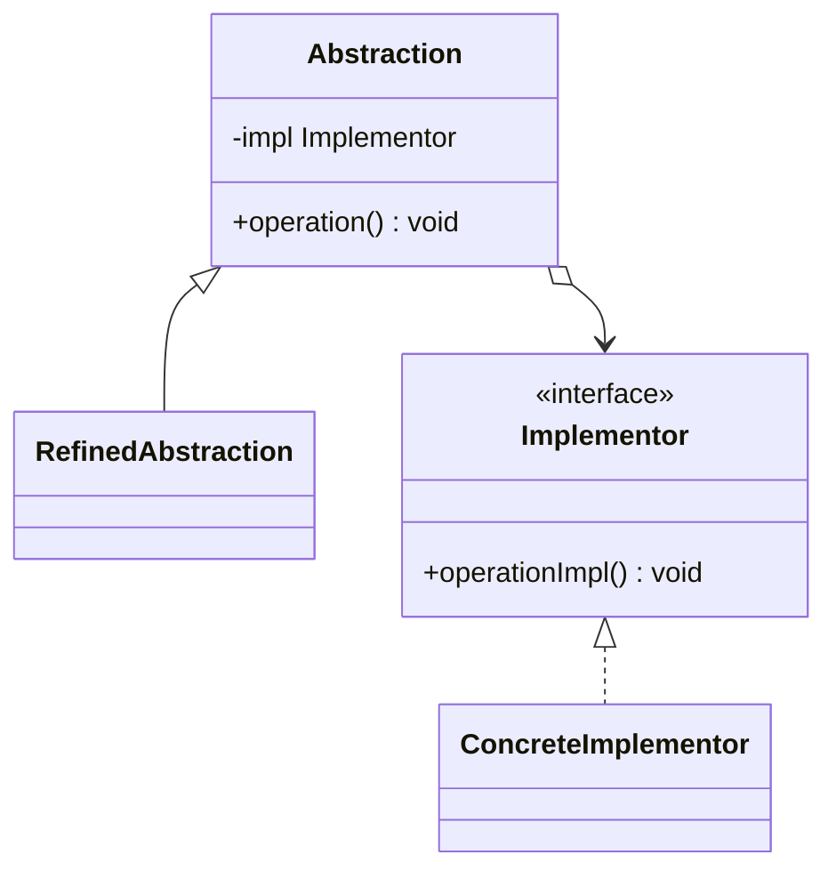

# Bridge Pattern

> Decouples an abstraction from its implementation so that the two can vary independently.

## Intent

Bridge is a **structural** design pattern. It splits abstraction and implementation into two independent hierarchies connected by a "bridge" interface, so each can be extended on its own, avoiding the class-hierarchy explosion caused by inheritance.

## Problem

When a class has multiple dimensions of variation (such as abstraction vs. concrete implementation), handling them with inheritance makes the class hierarchy explode and tightly couples abstraction to implementation, hindering independent extension.

## Solution

Bridge separates abstraction from implementation; the abstraction holds a reference to the implementation interface and delegates calls through it. The two sides can then vary independently, embodying the "composition over inheritance" principle.

| Role | Description |
|------|-------------|
| Abstraction | Defines the high-level abstraction, holding a reference to the implementation interface |
| Refined abstraction | Extends the abstraction with more specific operations |
| Implementor | Defines the implementation interface |
| Concrete implementor | Provides a concrete implementation |

## Structure

- **Abstraction**: defines the high-level interface and holds an implementation reference.
- **RefinedAbstraction**: extends the abstraction with more specific operations.
- **Implementor**: defines the implementation-layer interface.
- **ConcreteImplementor**: provides a concrete implementation.

## Effects

**Pros**

- **Flexibility and extensibility**: abstraction and implementation vary independently, avoiding hierarchy explosion.
- **Easy extension**: new abstractions or implementations do not affect each other.

**Cons**

- **More complexity**: more classes and objects must be managed.

**When to use**

- When you need to handle multiple dimensions of variation while keeping a clear, maintainable structure.

## Cases in this project

- [Remote & Device](remotedevice/README.md) — separates remote abstraction from device implementation.
- [Shape & Color](shapecolor/README.md) — separates shape abstraction from color implementation.