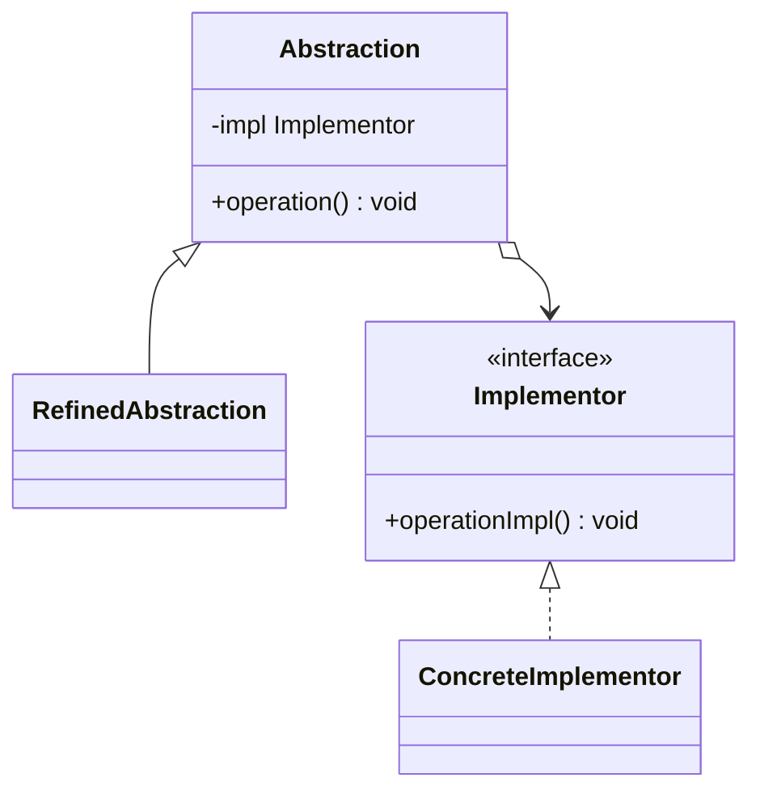

# 桥接模式（Bridge）

> 将抽象部分与它的实现部分分离，使它们都可以独立地变化。

## 意图

桥接模式（Bridge）是一种**结构型**设计模式。它把抽象与实现拆成两个独立的层次，通过「桥接」接口连接，使两者可以各自独立地扩展，避免继承带来的类层次爆炸。

## 问题

当一个类存在多个变化维度（如抽象与具体实现）时，用继承处理会导致类层次急剧膨胀，且抽象与实现被紧密耦合，难以独立扩展。

## 解决方案

桥接模式将抽象与实现分离，抽象持有对实现接口的引用，通过该引用把调用委托给具体实现。抽象与实现因此可以独立变化，这也体现了「组合优于继承」的原则。

| 角色 | 说明 |
|------|------|
| 抽象 | 定义高层抽象，持有对实现接口的引用 |
| 精化抽象 | 扩展抽象，增加更具体的操作 |
| 实现 | 定义实现接口 |
| 具体实现 | 实现实现接口 |

## 结构

- **抽象（Abstraction）**：定义高层接口，持有实现引用。
- **精化抽象（RefinedAbstraction）**：扩展抽象，提供更具体的操作。
- **实现（Implementor）**：定义实现层接口。
- **具体实现（ConcreteImplementor）**：提供具体实现。

## 效果

**优点**

- **灵活性与可扩展性**：抽象与实现独立变化，避免类层次爆炸。
- **易于扩展**：新增抽象或实现互不影响。

**缺点**

- **增加复杂度**：需要管理更多的类与对象。

**适用场景**

- 需要处理多个变化维度、又希望保持清晰结构与可维护性的场景。

## 项目中的案例

- [遥控器与设备](remotedevice/README_zh.md) —— 用桥接分离遥控器抽象与设备实现。
- [图形着色](shapecolor/README_zh.md) —— 用桥接分离图形抽象与颜色实现。