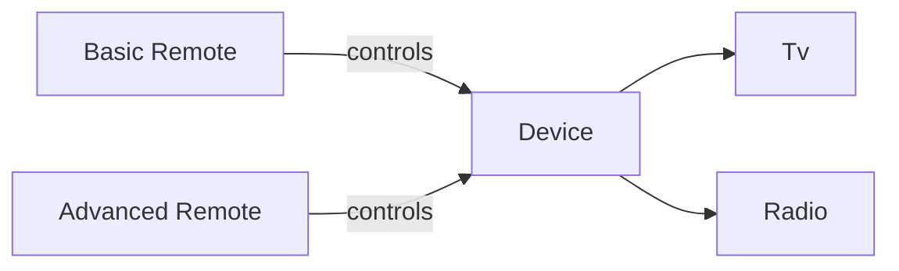
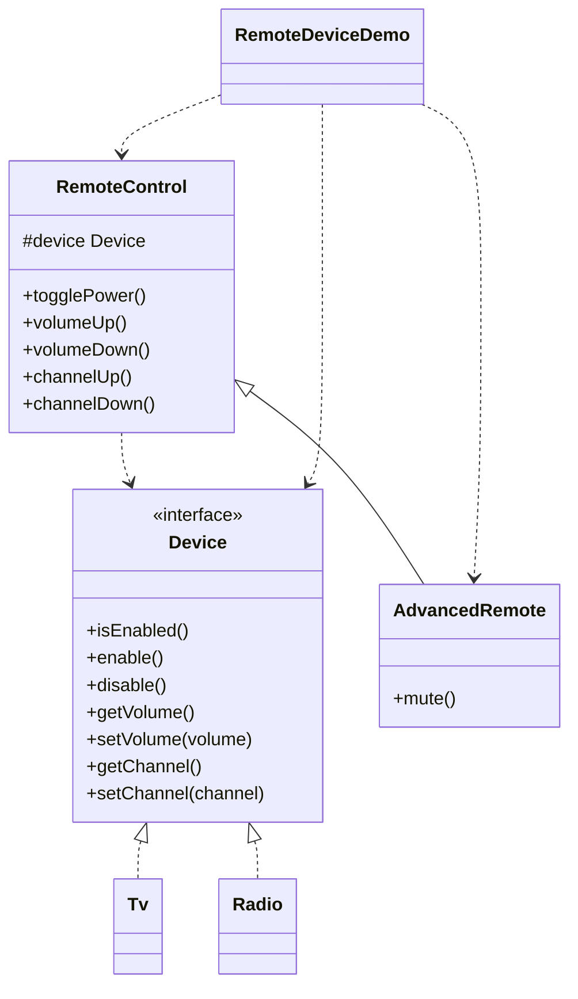

# Remote & Device — Bridge

> Splits remote controls (abstraction) from devices (implementation) so each
> dimension can grow independently.

## Big Picture

## Scenario

We have different devices (TV, radio) and different remotes (a basic remote
and an advanced remote with mute). If we modeled every combination as a
separate class, the number of classes would explode. Instead, remotes hold a
`Device` reference and delegate to it, so remotes and devices evolve
independently.

## Design Pattern

**Bridge** — decouples an abstraction from its implementation so the two can
vary independently.

Why it fits:

- `RemoteControl` is the **abstraction**; `Device` is the **implementor**.
- `Tv` and `Radio` are interchangeable implementations.
- `AdvancedRemote` extends the abstraction without touching any device.

## Structure

| Role | Participants |
|------|--------------|
| Implementor | `Device` |
| Concrete implementors | `Tv`, `Radio` |
| Abstraction | `RemoteControl` |
| Refined abstraction | `AdvancedRemote` |
| Client / demo | `RemoteDeviceDemo` |

## Design Rationale

- This is the canonical GoF bridge example, distinct from the existing
  "Shape & Color" pair (remote/device vs. shape/color).
- The two dimensions are clearly separated, showing why bridge avoids a
  class explosion.
- One file per type, following the Java convention, keeps each role readable.