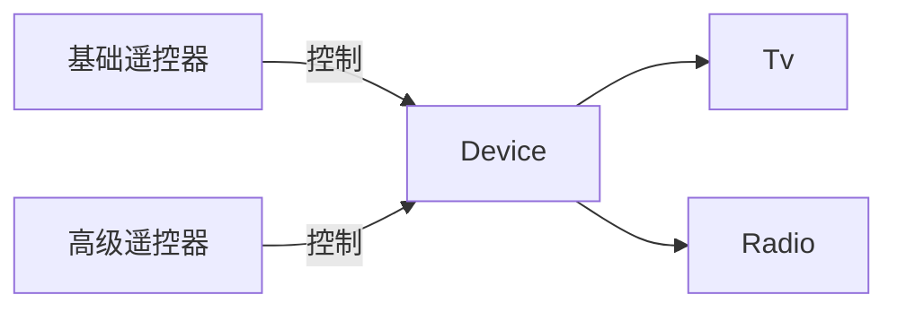
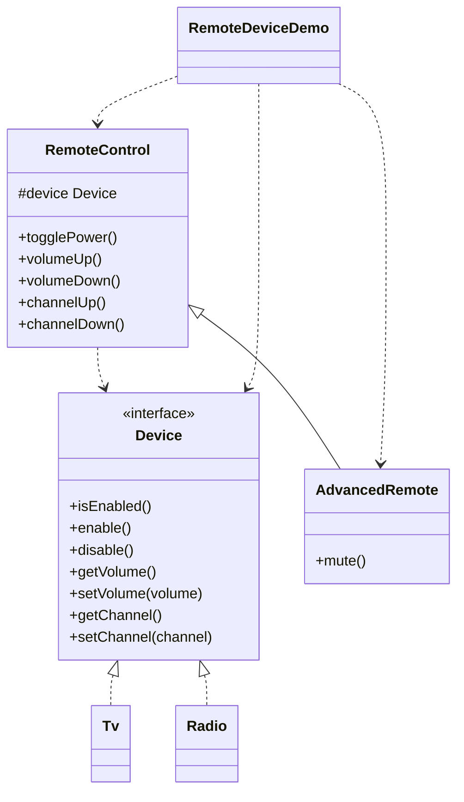

# 遥控器与设备 — 桥接

> 把遥控器（抽象）与设备（实现）拆开，让两个维度各自独立扩展。

## 整体概览

## 场景描述

我们有不同设备（电视、收音机）和不同遥控器（基础遥控器、带静音的高级遥控器）。
如果把每种组合都写成一个类，类数量会爆炸。于是遥控器持有一个 `Device` 引用并
委托给它，遥控器与设备各自独立演进。

## 设计模式

**桥接** —— 将抽象与其实现解耦，使两者可以独立变化。

为什么匹配：

- `RemoteControl` 是**抽象化角色**，`Device` 是**实现接口**。
- `Tv`、`Radio` 是可以互换的实现。
- `AdvancedRemote` 扩展抽象，而无需改动任何设备。

## 结构

| 角色 | 参与者 |
|------|--------|
| 实现接口 | `Device` |
| 具体实现 | `Tv`、`Radio` |
| 抽象化角色 | `RemoteControl` |
| 扩展抽象化 | `AdvancedRemote` |
| 客户端 / 演示 | `RemoteDeviceDemo` |

## 设计理念

- 这是 GoF 桥接的经典示例，与已有的"图形着色"区分（遥控器/设备 vs 图形/颜色）。
- 两个维度清晰分离，直观说明桥接如何避免类爆炸。
- 遵循 Java 惯例一个类型一个文件，让每个角色都清晰可读。