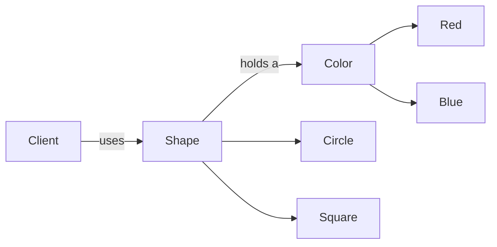
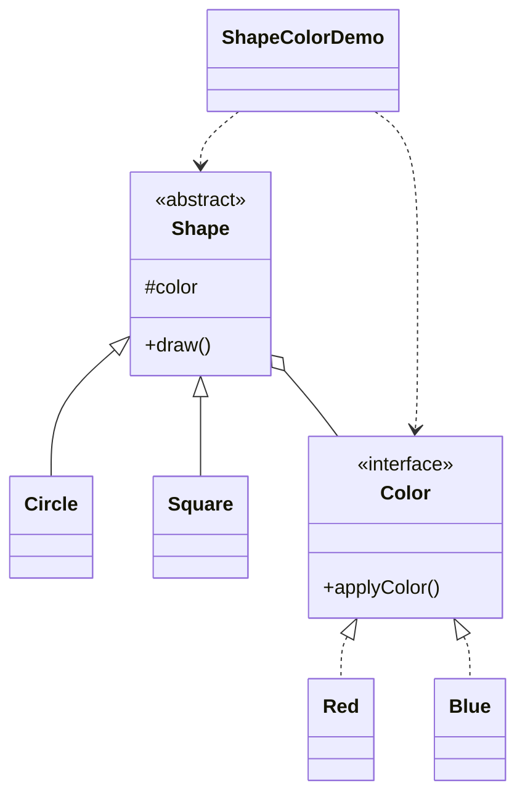

# Shape & Color — Bridge

> Separates a shape abstraction from its color implementation, so the two
> dimensions can vary independently without class explosion.

## Big Picture

## Scenario

Shapes can be drawn in many colors. If every shape-color combination were a
class, we would need `RedCircle`, `BlueCircle`, `RedSquare`, `BlueSquare`, and
the list grows with every new shape or color. Instead, each shape holds a
reference to a `Color`, so a circle can be drawn red or blue by injection.

## Design Pattern

**Bridge** — decouples an abstraction from its implementation so the two can
vary independently.

Why it fits:

- `Shape` is the **abstraction**; `Color` is the **implementation**.
- `Circle`/`Square` are refined abstractions; `Red`/`Blue` are concrete
  implementations.
- A shape is composed with a color at runtime rather than via inheritance.

## Structure

| Role | Participants |
|------|--------------|
| Implementation | `Color` |
| Concrete implementations | `Red`, `Blue` |
| Abstraction | `Shape` |
| Refined abstractions | `Circle`, `Square` |
| Client / demo | `ShapeColorDemo` |

## Design Rationale

- Composition ("has-a" color) replaces the inheritance matrix, which is the
  essence of the bridge pattern.
- Adding a new color or shape touches only one new class, not a whole matrix.
- One file per type keeps the two orthogonal dimensions visually separated.