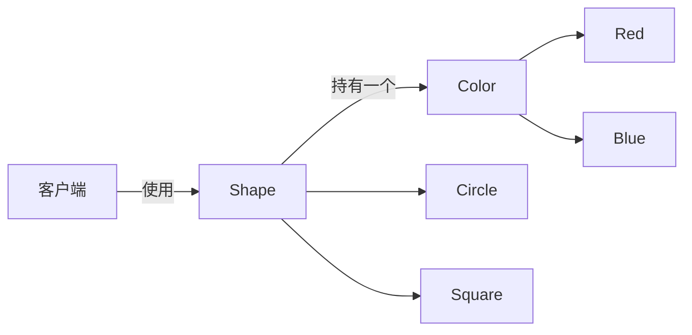
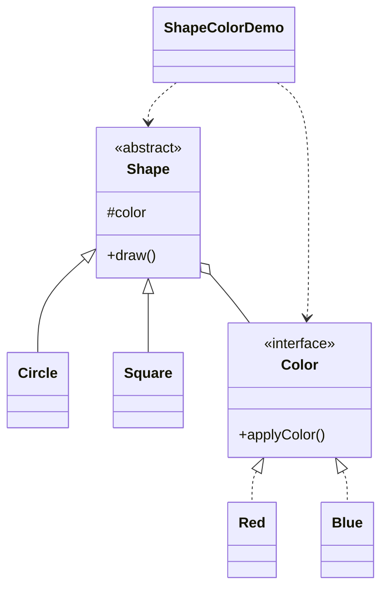

# 图形着色 — 桥接

> 把「形状」抽象与「颜色」实现分离，让两个维度独立变化而不产生类爆炸。

## 整体概览

## 场景描述

图形可以有很多颜色。如果每种「形状 × 颜色」组合都做成一个类，就需要
`RedCircle`、`BlueCircle`、`RedSquare`、`BlueSquare`……而且每新增一种形状或颜色
类都会成倍增长。改为让每个形状持有一个 `Color` 引用，就能通过注入给圆形上红
色或蓝色。

## 设计模式

**桥接** —— 将抽象与实现解耦，使二者可以独立变化。

为什么匹配：

- `Shape` 是**抽象化**，`Color` 是**实现**。
- `Circle`/`Square` 是细化抽象，`Red`/`Blue` 是具体实现。
- 形状在运行时通过组合持有颜色，而不是靠继承。

## 结构

| 角色 | 参与者 |
|------|--------|
| 实现 | `Color` |
| 具体实现 | `Red`、`Blue` |
| 抽象化 | `Shape` |
| 细化抽象 | `Circle`、`Square` |
| 客户端 / 演示 | `ShapeColorDemo` |

## 设计理念

- 用组合（「拥有」一个颜色）取代继承矩阵，这正是桥接模式的精髓。
- 新增一种颜色或形状只需新增一个类，而不是新增一整个矩阵。
- 一个类型一个文件，让两个正交维度在结构上清晰分离。