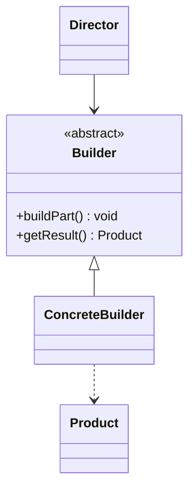

# Builder Pattern

> Separates the construction of a complex object from its representation so that the same construction process can create different representations.

## Intent

Builder is a **creational** design pattern. It encapsulates the construction of a complex object in a dedicated builder class, orchestrated by a director in a fixed order, thereby separating "how it is built" from "what it finally looks like".

## Problem

Some objects are very complex to create, involving multiple steps, each of which may have different implementations. Putting all the creation logic in one class makes it huge and hard to maintain; creating different variants means adding even more logic to the same class, making the code messier.

## Solution

Builder hands the construction process to a dedicated builder class, while a Director controls the order. Different concrete builders implement different construction steps to produce different product variants.

| Role | Description |
|------|-------------|
| Product | The complex object being built |
| Abstract builder | Declares the construction steps without providing implementations |
| Concrete builder | Implements the abstract builder to build a specific product variant |
| Director | Controls the construction process, invoking the builder in a fixed order |

## Structure

- **Product**: the final object being built.
- **Builder**: declares the construction steps and the result-getting method.
- **ConcreteBuilder**: implements the steps to produce a specific product variant.
- **Director**: holds a builder reference and schedules the steps in order, decoupling clients from concrete builders.

## Effects

**Pros**

- **Separates construction from representation**: the build process stays clear and controllable.
- **Supports different representations**: switching concrete builders yields different products without changing client code.
- **Extensibility**: new variants are added via new concrete builders.
- **Hides internal structure**: clients interact only with the abstract builder and director.

**Cons**

- **More classes**: one concrete builder is needed per product variant.

**When to use**

- When you need to build complex objects whose construction involves multiple steps or variants.

## Cases in this project

- [Computer Builder](computerbuilder/README.md) — assembles computers with different configurations step by step.
- [House Builder](housebuilder/README.md) — builds standard and luxury houses step by step.