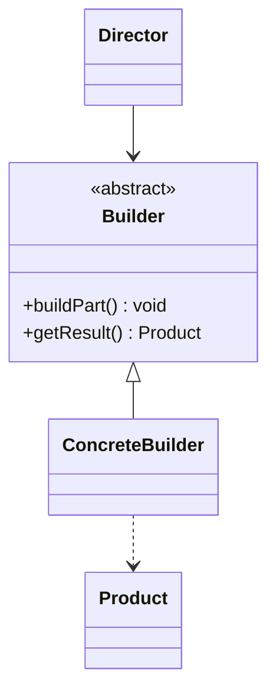

# 建造者模式（Builder）

> 将一个复杂对象的构建与它的表示分离，使得同样的构建过程可以创建不同的表示。

## 意图

建造者模式（Builder）是一种**创建型**设计模式。它把复杂对象的构建过程封装在独立的建造者类中，由指导者按固定顺序调用，从而把「如何构建」与「最终长什么样」分离开来。

## 问题

有些对象的创建过程非常复杂，涉及多个步骤，每个步骤又可能有不同的实现方式。若把全部创建逻辑塞进一个类，会让该类变得庞大且难以维护；而创建不同变体又要在同一个类里追加更多逻辑，使代码愈发混乱。

## 解决方案

建造者模式将构建过程交给独立的建造者类，由指导者（Director）控制构建顺序。不同的具体建造者实现不同的构建步骤，从而产出不同的产品变体。

| 角色 | 说明 |
|------|------|
| 产品 | 正在构建的复杂对象 |
| 抽象建造者 | 定义构建步骤，但不提供具体实现 |
| 具体建造者 | 实现抽象建造者，完成特定产品变体的构建 |
| 指导者 | 控制构建过程，按固定顺序和规则调用建造者 |

## 结构

- **产品（Product）**：构建的最终产物。
- **抽象建造者（Builder）**：声明各构建步骤与获取结果的方法。
- **具体建造者（ConcreteBuilder）**：实现构建步骤，产出特定产品变体。
- **指导者（Director）**：持有建造者引用，按顺序调度构建步骤，使客户端与具体建造者分离。

## 效果

**优点**

- **分离构建与表示**：构建过程清晰可控。
- **支持不同表示**：切换具体建造者即可得到不同产品，客户端代码不变。
- **可扩展性**：新增产品变体只需新增具体建造者。
- **隐藏内部结构**：客户端只与抽象建造者和指导者交互。

**缺点**

- **类数量增加**：为每种产品变体都需要一个具体建造者。

**适用场景**

- 需要构建复杂对象、且构建过程涉及多个步骤或多种变体的场景。

## 项目中的案例

- [电脑组装](computerbuilder/README_zh.md) —— 用建造者分步组装不同配置的电脑。
- [房屋建造](housebuilder/README_zh.md) —— 用建造者分步建造普通房屋与豪华房屋。