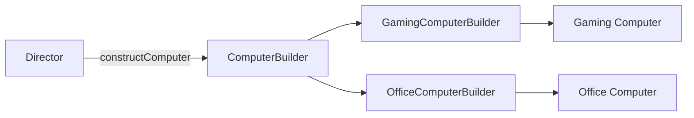
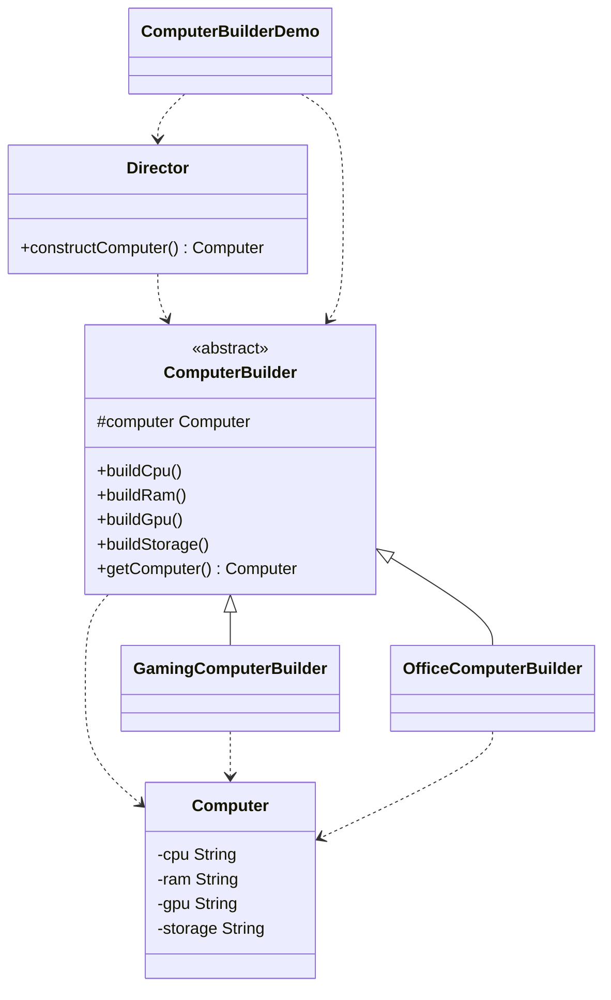

# Computer Builder — Builder

> Assembles different computer configurations (gaming / office) with the same
> construction steps, separating product parts from the build process.

## Big Picture

## Scenario

A PC store sells computers with different configurations — a high-end gaming
machine and an economical office machine. Both are assembled with the same
four steps (CPU, RAM, GPU, storage), but each builder fills in different
parts. The `Director` runs the same sequence regardless of which builder is
passed in.

## Design Pattern

**Builder** — separates the construction of a complex object from its
representation, so the same construction process can create different
representations.

Why it fits:

- The product (`Computer`) has **multiple parts** assembled in a fixed order.
- Two concrete builders produce **different representations** of the same
  product.
- The `Director` encodes the construction steps once and reuses them across
  builders.

## Structure

| Role | Participants |
|------|--------------|
| Product | `Computer` |
| Abstract builder | `ComputerBuilder` |
| Concrete builders | `GamingComputerBuilder`, `OfficeComputerBuilder` |
| Director | `Director` |
| Client / demo | `ComputerBuilderDemo` |

## Design Rationale

- A four-part product keeps the build steps compact while still showing the
  product/builder/director split.
- The scenario is clearly distinct from "House Builder" (hardware vs. real
  estate), yet shares the same pedagogical structure for easy comparison.
- One file per type, following the Java convention, keeps each role readable.