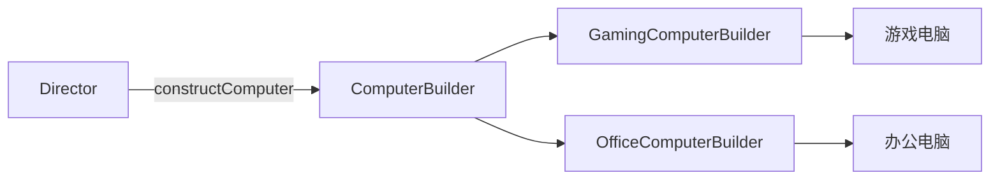
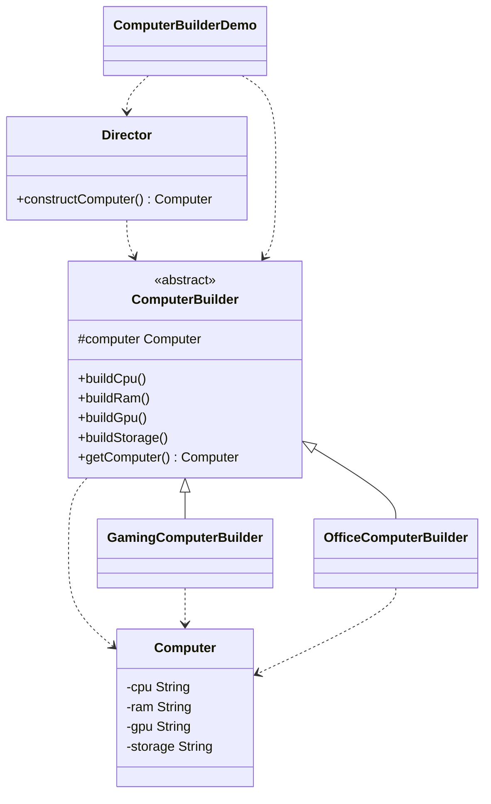

# 电脑组装 — 建造者

> 用同一套组装步骤构建不同配置的电脑（游戏 / 办公），
> 把产品部件与构建过程分离。

## 整体概览

## 场景描述

一家电脑店售卖不同配置的电脑——高端游戏机和实惠办公机。两者都按同样的四个步骤
（CPU、内存、显卡、硬盘）组装，但每个建造者填入不同的部件。`Director` 无论传入
哪个建造者，都执行同一套组装顺序。

## 设计模式

**建造者** —— 将复杂对象的构建与其表示分离，使同样的构建过程能产生不同表示。

为什么匹配：

- 产品（`Computer`）包含**多个部件**，按固定顺序组装。
- 两个具体建造者产出同一产品的**不同表示**。
- `Director` 一次性定义构建步骤，并在多个建造者间复用。

## 结构

| 角色 | 参与者 |
|------|--------|
| 产品 | `Computer` |
| 抽象建造者 | `ComputerBuilder` |
| 具体建造者 | `GamingComputerBuilder`、`OfficeComputerBuilder` |
| 指挥者 | `Director` |
| 客户端 / 演示 | `ComputerBuilderDemo` |

## 设计理念

- 四部件产品既紧凑又能清晰展示 产品/建造者/指挥者 的三层拆分。
- 场景与"房屋建造"明显区分（硬件 vs 房产），又共享相同的教学结构便于对照。
- 遵循 Java 惯例一个类型一个文件，让每个角色都清晰可读。