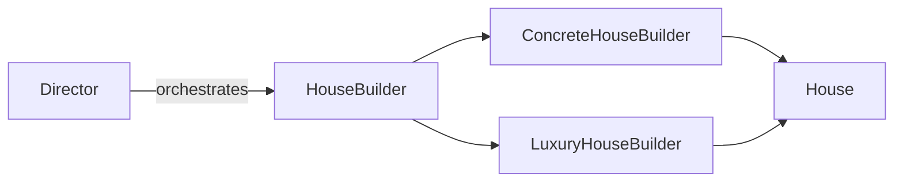
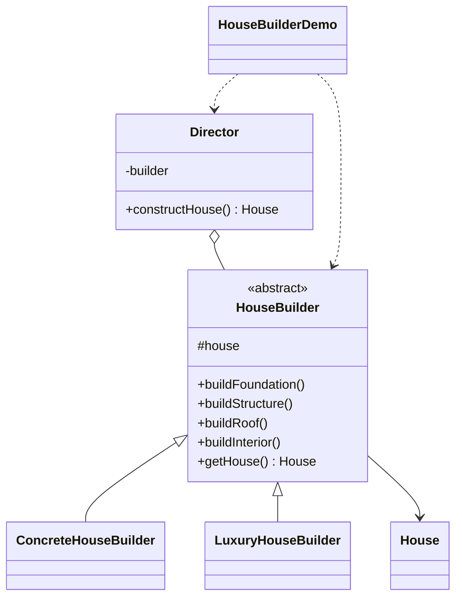

# House Builder — Builder

> Constructs a `House` step by step through a builder, letting the same build
> process produce different houses (standard vs. luxury).

## Big Picture

## Scenario

A house is assembled from several parts (foundation, structure, roof,
interior). Different kinds of houses share the same construction order but use
different materials. A `Director` drives a `HouseBuilder` through a fixed
sequence, while each concrete builder supplies its own parts.

## Design Pattern

**Builder** — separates the construction of a complex object from its
representation so the same process can create different representations.

Why it fits:

- `House` is the **complex product** with several parts.
- `HouseBuilder` declares the **construction steps**; `ConcreteHouseBuilder` and
  `LuxuryHouseBuilder` implement them differently.
- `Director` controls the **build order** independently of the concrete builder.

## Structure

| Role | Participants |
|------|--------------|
| Product | `House` |
| Builder | `HouseBuilder` |
| Concrete builders | `ConcreteHouseBuilder`, `LuxuryHouseBuilder` |
| Director | `Director` |
| Client / demo | `HouseBuilderDemo` |

## Design Rationale

- The two house variants differ only in part content, so one `Director` works
  for both — this is exactly the reuse the builder pattern promises.
- Keeping the product plain (`House` with setters) makes the construction steps
  explicit and easy to follow.
- One file per type separates product, builder, concrete builders and director.