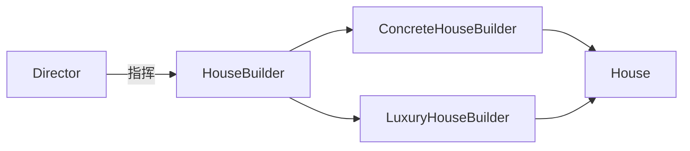
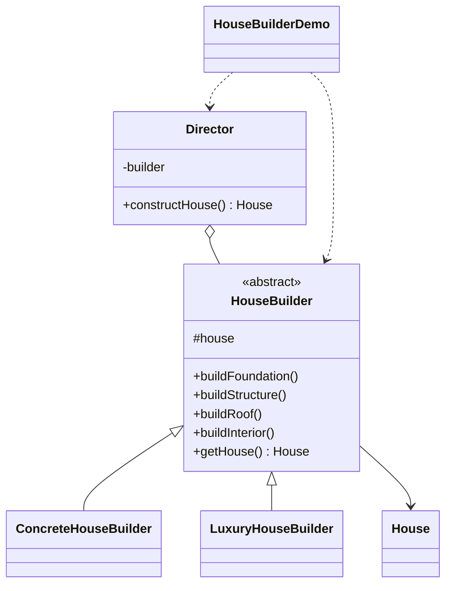

# 房屋建造 — 建造者

> 通过建造者一步步组装 `House`，让同一条建造流程产出不同的房屋（普通 / 豪华）。

## 整体概览

## 场景描述

一栋房子由多个部分组成（地基、结构、屋顶、内部装修）。不同房子共享相同的建造
顺序，却使用不同的材料。`Director` 按固定顺序驱动 `HouseBuilder`，而每个具体
建造者提供各自的部件。

## 设计模式

**建造者** —— 将复杂对象的构建与其表示分离，使同一构建过程可以创建不同的表示。

为什么匹配：

- `House` 是拥有多个部件的**复杂产品**。
- `HouseBuilder` 声明**建造步骤**；`ConcreteHouseBuilder` 与 `LuxuryHouseBuilder`
  以不同方式实现它们。
- `Director` 独立于具体建造者地控制**建造顺序**。

## 结构

| 角色 | 参与者 |
|------|--------|
| 产品 | `House` |
| 建造者 | `HouseBuilder` |
| 具体建造者 | `ConcreteHouseBuilder`、`LuxuryHouseBuilder` |
| 指挥者 | `Director` |
| 客户端 / 演示 | `HouseBuilderDemo` |

## 设计理念

- 两种房屋只差在部件内容，因此同一个 `Director` 对两者都适用——这正是建造者
  模式承诺的复用能力。
- 产品保持朴素（`House` 只有 setter），让建造步骤清晰可循。
- 一个类型一个文件，产品、建造者、具体建造者与指挥者各归其位。