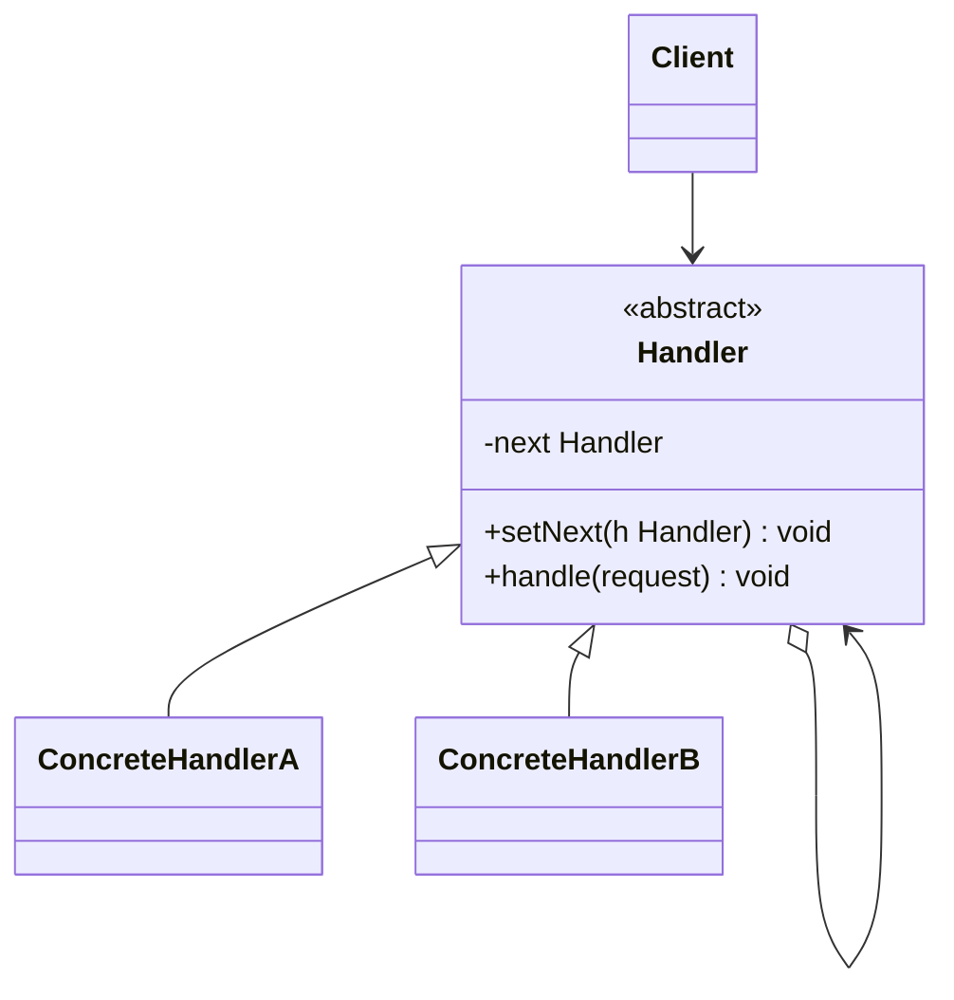

# Chain of Responsibility Pattern

> Avoids coupling the sender of a request to its receiver by giving more than one object a chance to handle the request, chaining the receiving objects and passing the request along the chain until an object handles it.

## Intent

Chain of Responsibility is a **behavioral** design pattern. It links multiple handlers into a chain through which requests pass until one handles them, decoupling senders from receivers.

## Problem

A request may need to be passed among multiple objects, each of which may handle it or forward it to the next. The goal is to avoid coupling sender and receiver while allowing the order and responsibilities to change dynamically.

## Solution

Chain of Responsibility gives each handler a reference to the next handler, forming a chain. A request enters the head of the chain; a handler processes it if able, otherwise forwards it to the next.

| Role | Description |
|------|-------------|
| Handler | Declares the handling method and holds a reference to the next handler |
| Concrete handler | Implements the handling method, deciding to process or pass the request |

## Structure

- **Handler**: defines the handling interface and holds a successor reference.
- **ConcreteHandler**: decides whether to handle, otherwise forwards to the successor.
- **Client**: sends the request only to the head of the chain.

## Effects

**Pros**

- **Lower coupling**: the sender need not know who handles the request.
- **Flexibility**: handler order and responsibilities can change dynamically.
- **Extensibility**: new handlers are easy to add.
- **Maintainability**: each handler focuses on a single responsibility.

**Cons**

- **Unhandled requests**: a request may reach the end of the chain without being handled.
- **Long chains hurt performance**: a very long chain adds overhead.

**When to use**

- When multiple objects should get a chance to handle a request in turn while decoupling senders from receivers.

## Cases in this project

- [Log Filter](logfilter/README.md) — filters logs by level along a chain.
- [Reimbursement](reimbursement/README.md) — approves reimbursements by amount along a chain.