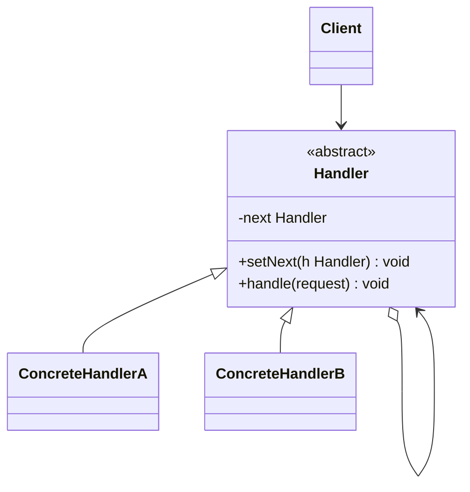

# 责任链模式（Chain of Responsibility）

> 使多个对象都有机会处理请求，从而避免请求的发送者和接收者之间的耦合关系。将这些对象连成一条链，并沿着这条链传递该请求，直到有一个对象处理它为止。

## 意图

责任链模式（Chain of Responsibility）是一种**行为型**设计模式。它把多个处理者连成一条链，请求沿链传递，直到某个处理者处理为止，从而解耦发送者与接收者。

## 问题

一个请求需要在多个对象间传递，每个对象都可能处理或转交给下一个对象。需要避免发送者与接收者耦合，并支持动态调整处理顺序与职责。

## 解决方案

责任链模式让每个处理者持有对下一个处理者的引用，形成链式结构。请求从链首传入，能处理则处理，否则传递给下一个，直到被处理。

| 角色 | 说明 |
|------|------|
| 处理者 | 声明处理请求的方法，并持有对下一个处理者的引用 |
| 具体处理者 | 实现处理方法，决定处理或传递请求 |

## 结构

- **处理者（Handler）**：定义处理接口并持有后继引用。
- **具体处理者（ConcreteHandler）**：决定是否处理，不能处理则转交后继。
- **客户端（Client）**：只把请求发送到链首。

## 效果

**优点**

- **降低耦合**：发送者无需知道谁处理请求。
- **灵活**：可动态调整处理者顺序与职责。
- **可扩展**：易于添加新处理者。
- **可维护**：每个处理者关注单一职责。

**缺点**

- **可能无人处理**：请求可能走到链尾仍未被处理。
- **链过长影响性能**：传递链太长会带来开销。

**适用场景**

- 需要多个对象依次尝试处理请求、且希望解耦发送者与接收者的场景。

## 项目中的案例

- [日志过滤](logfilter/README_zh.md) —— 用责任链按级别依次过滤日志。
- [报销审批](reimbursement/README_zh.md) —— 用责任链按金额逐级审批报销单。