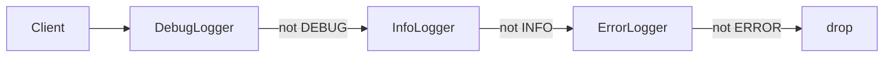
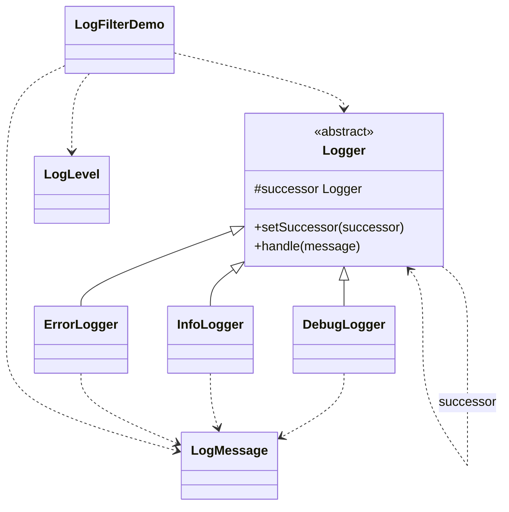

# Log Filter — Chain of Responsibility

> Routes a log message through DEBUG → INFO → ERROR handlers until one of
> them matches its level.

## Big Picture

## Scenario

A logging system receives messages of different levels. Instead of a single
method with lots of `if/else`, each level has its own handler linked into a
chain. A message travels down the chain until a handler claims it.

## Design Pattern

**Chain of Responsibility** — passes a request along a chain of handlers
until one handles it.

Why it fits:

- `Logger` is the abstract handler holding a `successor`.
- `DebugLogger`, `InfoLogger`, `ErrorLogger` each handle one level and pass
  the rest on.
- The chain is assembled and reordered at runtime without changing handlers.

## Structure

| Role | Participants |
|------|--------------|
| Handler | `Logger` |
| Concrete handlers | `DebugLogger`, `InfoLogger`, `ErrorLogger` |
| Request | `LogMessage`, `LogLevel` |
| Client / demo | `LogFilterDemo` |

## Design Rationale

- The log-level scenario is a classic chain, clearly distinct from the
  existing "Reimbursement" (amount tiers) example.
- Exact level matching plus pass-through shows how a request walks the chain.
- One file per type, following the Java convention, keeps each role readable.