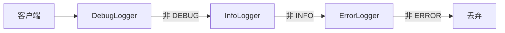
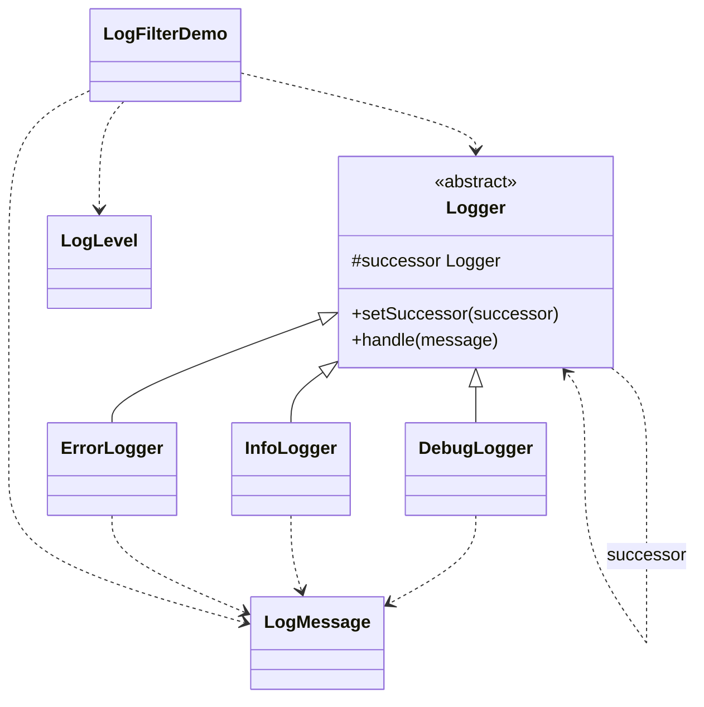

# 日志过滤 — 责任链

> 让日志消息沿 DEBUG → INFO → ERROR 处理者一路传递，直到某个处理者匹配其级别。

## 整体概览

## 场景描述

日志系统会收到不同级别的消息。与其用一个满是 `if/else` 的方法，不如每种级别各配
一个处理者并串成链条。消息沿链传递，直到某个处理者认领它。

## 设计模式

**责任链** —— 沿处理者链条传递请求，直到某个处理者处理它。

为什么匹配：

- `Logger` 是持有 `successor` 的抽象处理者。
- `DebugLogger`、`InfoLogger`、`ErrorLogger` 各处理一个级别，其余继续传递。
- 链条可在运行时组装、重排，而无需改动各处理者。

## 结构

| 角色 | 参与者 |
|------|--------|
| 处理者 | `Logger` |
| 具体处理者 | `DebugLogger`、`InfoLogger`、`ErrorLogger` |
| 请求 | `LogMessage`、`LogLevel` |
| 客户端 / 演示 | `LogFilterDemo` |

## 设计理念

- 日志分级场景是责任链的经典示例，与已有的"报销审批"（按金额分级）明显区分。
- 精确的级别匹配 + 向下传递，直观展示请求如何在链上流转。
- 遵循 Java 惯例一个类型一个文件，让每个角色都清晰可读。