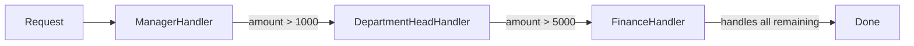
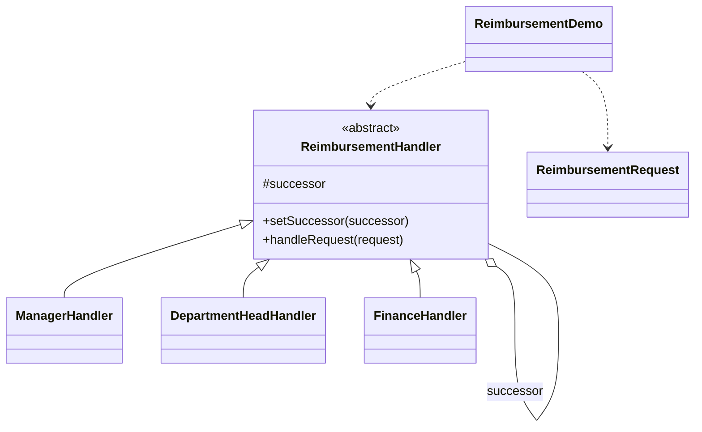

# Reimbursement — Chain of Responsibility

> Passes a reimbursement request along a chain of approvers (manager → department
> head → finance) until someone handles it based on the amount.

## Big Picture

## Scenario

A company approves reimbursement by amount: a manager handles up to 1000, a
department head up to 5000, and finance handles everything above. Each handler
only knows its successor, so the sender never hard-codes who will approve a
given request.

## Design Pattern

**Chain of Responsibility** — avoids coupling the sender of a request to its
receiver by giving more than one object a chance to handle the request.

Why it fits:

- `ReimbursementHandler` is the **abstract handler** with a `successor` link.
- Each concrete handler either handles the request or forwards it along the chain.
- The chain (`manager → departmentHead → finance`) is assembled by the client,
  not baked into the request sender.

## Structure

| Role | Participants |
|------|--------------|
| Handler | `ReimbursementHandler` |
| Concrete handlers | `ManagerHandler`, `DepartmentHeadHandler`, `FinanceHandler` |
| Request | `ReimbursementRequest` |
| Client / demo | `ReimbursementDemo` |

## Design Rationale

- Each handler keeps a single responsibility and one forward link, so the chain
  can be reordered or extended without touching the request or the client.
- Amount thresholds make the "handle or pass on" decision easy to verify at a glance.
- One file per type keeps the chain links clearly separated.