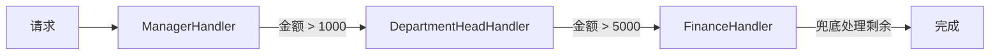
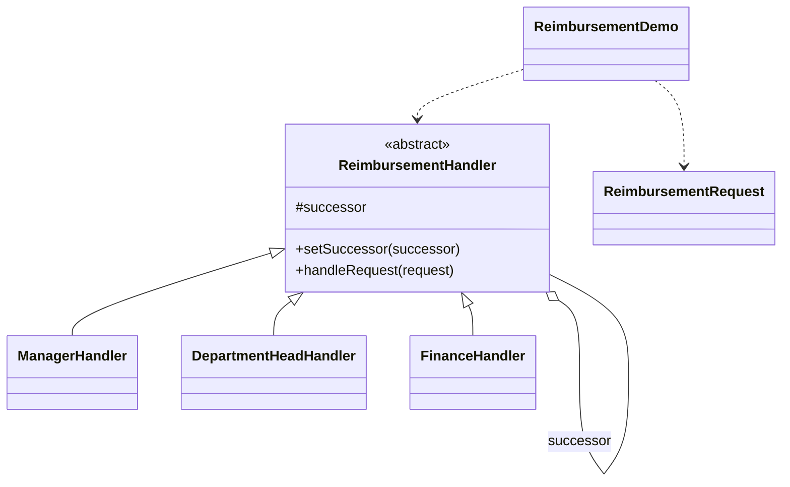

# 报销审批 — 责任链

> 让报销请求沿审批链（经理 → 部门主管 → 财务）传递，直到有人根据金额处理它。

## 整体概览

## 场景描述

公司按金额审批报销：经理审批 1000 元以内，部门主管审批 5000 元以内，超出部分由
财务处理。每个处理者只知道自己的后继者，因此发送方无需硬编码「谁来审批」。

## 设计模式

**责任链** —— 通过给多个对象处理请求的机会，避免请求发送者与接收者之间的耦合。

为什么匹配：

- `ReimbursementHandler` 是带 `successor` 链接的**抽象处理者**。
- 每个具体处理者要么处理请求，要么沿链继续传递。
- 链条（经理 → 部门主管 → 财务）由客户端组装，而非写死在请求发送方。

## 结构

| 角色 | 参与者 |
|------|--------|
| 处理者 | `ReimbursementHandler` |
| 具体处理者 | `ManagerHandler`、`DepartmentHeadHandler`、`FinanceHandler` |
| 请求 | `ReimbursementRequest` |
| 客户端 / 演示 | `ReimbursementDemo` |

## 设计理念

- 每个处理者只承担一个职责和一条前向链接，因此链条可以重排或扩展而无需改动
  请求或客户端。
- 金额阈值让「处理还是传递」的决策一目了然、便于验证。
- 一个类型一个文件，链条各环节清晰分离。