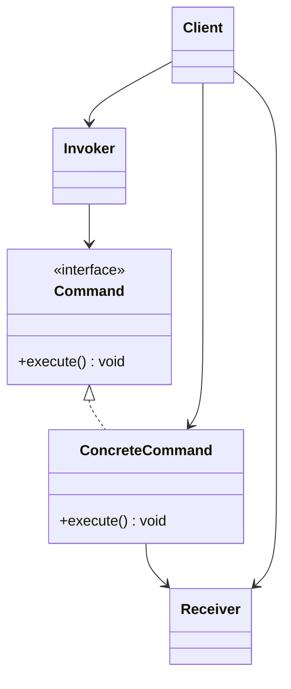

# Command Pattern

> Encapsulates a request as an object, thereby letting you parameterize clients with different requests, queue or log requests, and support undoable operations.

## Intent

Command is a **behavioral** design pattern. It encapsulates a request as a command object, decoupling the sender from the receiver and enabling queuing, logging, undo and redo.

## Problem

Sometimes you want to decouple the request sender from the receiver so requests can be organized and handled in different ways — queued, logged, undone or redone — without changing the code between them.

## Solution

Command encapsulates a request as a command object that binds a receiver to an action; the invoker triggers execution, so the sender and receiver are not directly coupled.

| Role | Description |
|------|-------------|
| Command | Declares the execution interface |
| Concrete command | Binds a receiver to an action and implements execution |
| Receiver | Performs the actual work |
| Invoker | Holds a command and triggers its execution |
| Client | Creates and wires the command, receiver and invoker |

## Structure

- **Command**: declares the execution interface.
- **ConcreteCommand**: binds a receiver and invokes its operation.
- **Receiver**: the object doing the actual work.
- **Invoker**: holds a command and triggers execution.
- **Client**: creates and wires the objects.

## Effects

**Pros**

- **Decoupling**: sender and receiver are not directly coupled.
- **Flexible organization**: supports queuing, logging, undo and redo.
- **Easy extension**: new operations come from new commands.

**Cons**

- **More command classes**: every operation needs a concrete command class.

**When to use**

- When you need to decouple request senders from receivers and support flexible command handling, such as menus, GUI actions and multi-level undo.

## Cases in this project

- [Text Editor](texteditorcommand/README.md) — encapsulates text editing as commands with undo.
- [Light Switch](lightcontrol/README.md) — encapsulates turning a light on and off.