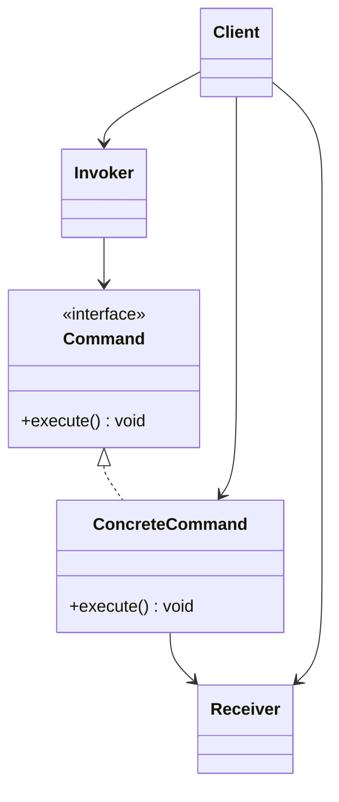

# 命令模式（Command）

> 将一个请求封装为一个对象，从而使你可用不同的请求对客户进行参数化，对请求排队或记录请求日志，以及支持可撤销的操作。

## 意图

命令模式（Command）是一种**行为型**设计模式。它把请求封装成命令对象，使请求发送者与接收者解耦，从而支持排队、记录、撤销与重做。

## 问题

有时希望将请求发送者与接收者解耦，以便以不同方式组织与处理请求，例如排队、记录、撤销或重做，而无需修改发送者与接收者之间的代码。

## 解决方案

命令模式把请求封装为命令对象，命令绑定接收者与动作，调用者负责触发执行，发送者与接收者因此不直接耦合。

| 角色 | 说明 |
|------|------|
| 命令 | 声明执行接口 |
| 具体命令 | 绑定接收者与动作，实现执行方法 |
| 接收者 | 执行实际工作 |
| 调用者 | 持有命令并触发执行 |
| 客户端 | 创建并组装命令、接收者与调用者 |

## 结构

- **命令（Command）**：声明执行接口。
- **具体命令（ConcreteCommand）**：绑定接收者，调用其具体操作。
- **接收者（Receiver）**：执行实际工作的对象。
- **调用者（Invoker）**：持有命令，触发执行。
- **客户端（Client）**：创建并组装各对象。

## 效果

**优点**

- **解耦**：发送者与接收者不直接耦合。
- **灵活组织**：支持排队、记录、撤销与重做。
- **易扩展**：新增命令即可新增操作。

**缺点**

- **命令类增多**：每个操作都需一个具体命令类。

**适用场景**

- 需要解耦请求发送者与接收者，并支持灵活命令处理的场景，如菜单、GUI 操作、多级撤销。

## 项目中的案例

- [文本编辑器](texteditorcommand/README_zh.md) —— 用命令封装文本编辑操作并支持撤销。
- [灯光控制](lightcontrol/README_zh.md) —— 用命令封装灯的开/关操作。