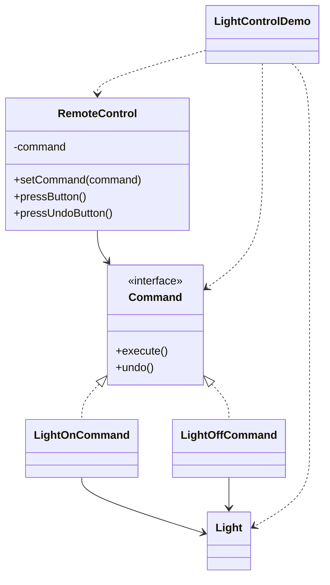

# Light Switch — Command

> Encapsulates "turn light on/off" as command objects, so a remote can execute
> and undo them without knowing the light's internals.

## Big Picture

## Scenario

A universal remote should work with any device without knowing its details. Each
action (on, off) is wrapped in a `Command` object with `execute()` and `undo()`.
The remote only talks to the `Command` interface, so it can be reused for many
devices and support undo.

## Design Pattern

**Command** — encapsulates a request as an object, allowing parameterization,
queueing, logging and undoable operations.

Why it fits:

- `Command` is the **command** interface with `execute()`/`undo()`.
- `LightOnCommand`/`LightOffCommand` are **concrete commands** that delegate to the
  receiver `Light`.
- `RemoteControl` is the **invoker**; it only knows the command interface.

## Structure

| Role | Participants |
|------|--------------|
| Command | `Command` |
| Concrete commands | `LightOnCommand`, `LightOffCommand` |
| Receiver | `Light` |
| Invoker | `RemoteControl` |
| Client / demo | `LightControlDemo` |

## Design Rationale

- Undo is implemented symmetrically (on's undo is off, and vice versa), which is
  the simplest way to show a reversible command.
- The receiver's methods stay concrete (`turnOn`/`turnOff`); commands only add a
  call layer on top.
- One file per type separates command, invoker and receiver cleanly.