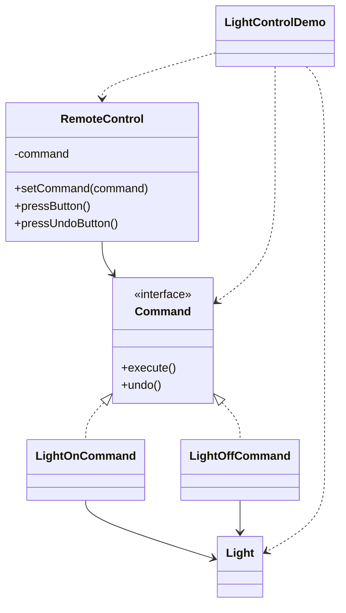

# 灯光控制 — 命令

> 把「开灯 / 关灯」封装成命令对象，让遥控器无需了解电灯内部即可执行与撤销。

## 整体概览

## 场景描述

万能遥控器应能适配任意设备而无需了解其细节。每个动作（开、关）都被包装成一个
带 `execute()` 和 `undo()` 的 `Command` 对象。遥控器只与 `Command` 接口打交道，
因此可复用于多种设备并支持撤销。

## 设计模式

**命令** —— 把请求封装为对象，从而支持参数化、排队、记录日志与撤销操作。

为什么匹配：

- `Command` 是带 `execute()`/`undo()` 的**命令**接口。
- `LightOnCommand`/`LightOffCommand` 是委托给接收者 `Light` 的**具体命令**。
- `RemoteControl` 是**调用者**，它只认识命令接口。

## 结构

| 角色 | 参与者 |
|------|--------|
| 命令 | `Command` |
| 具体命令 | `LightOnCommand`、`LightOffCommand` |
| 接收者 | `Light` |
| 调用者 | `RemoteControl` |
| 客户端 / 演示 | `LightControlDemo` |

## 设计理念

- 撤销采用对称实现（开灯的撤销是关灯，反之亦然），这是展示可逆命令的最简方式。
- 接收者的方法保持具体（`turnOn`/`turnOff`），命令只是在其上加了一层调用。
- 一个类型一个文件，命令、调用者与接收者清晰分离。