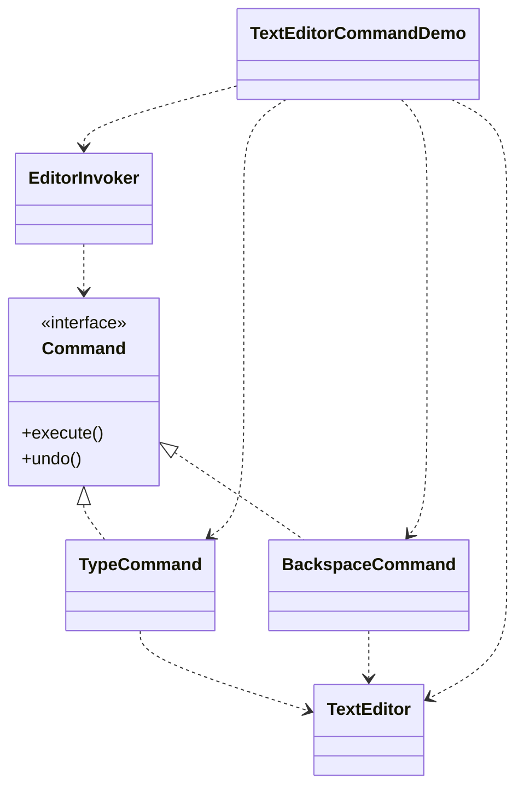

# Text Editor — Command

> Wraps typing and backspace as commands so an invoker can execute them and
> roll them back through an undo history.

## Big Picture

## Scenario

A text editor lets a user type and delete. Each action is captured as a
command object that knows how to perform and undo itself. An invoker keeps a
history of executed commands, so the last action can be rolled back on demand.

## Design Pattern

**Command** — turns a request into an object, allowing parameterization,
queueing, and undo.

Why it fits:

- `Command` declares `execute()` and `undo()`.
- `TypeCommand` and `BackspaceCommand` bind the editor (receiver) to actions.
- `EditorInvoker` holds a history and triggers execute/undo.

## Structure

| Role | Participants |
|------|--------------|
| Command | `Command` |
| Concrete commands | `TypeCommand`, `BackspaceCommand` |
| Receiver | `TextEditor` |
| Invoker | `EditorInvoker` |
| Client / demo | `TextEditorCommandDemo` |

## Design Rationale

- The undo-history editor highlights the command pattern's core motivation,
  distinct from the existing "Light Switch" (on/off) example.
- Multiple command types plus an undo stack show parameterization and
  rollback that direct method calls cannot provide.
- One file per type, following the Java convention, keeps each role readable.