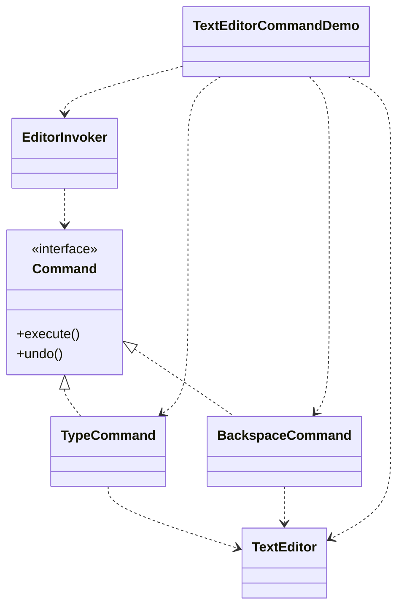

# 文本编辑器 — 命令

> 把输入与退格封装成命令，调用者可通过撤销历史执行并回滚它们。

## 整体概览

## 场景描述

文本编辑器允许用户输入与删除。每个动作被封装成命令对象，命令知道如何执行与撤销。
调用者维护已执行命令的历史，从而按需回滚上一步操作。

## 设计模式

**命令** —— 将请求封装为对象，从而支持参数化、排队与撤销。

为什么匹配：

- `Command` 声明 `execute()` 与 `undo()`。
- `TypeCommand`、`BackspaceCommand` 把接收者（编辑器）与动作绑定。
- `EditorInvoker` 维护历史并触发执行 / 撤销。

## 结构

| 角色 | 参与者 |
|------|--------|
| 命令 | `Command` |
| 具体命令 | `TypeCommand`、`BackspaceCommand` |
| 接收者 | `TextEditor` |
| 调用者 | `EditorInvoker` |
| 客户端 / 演示 | `TextEditorCommandDemo` |

## 设计理念

- 带撤销历史的编辑器凸显了命令模式的核心动机，与"灯光控制"（开/关）示例明显区分。
- 多种命令类型 + 撤销栈，展示了直接方法调用所不具备的参数化与回滚能力。
- 遵循 Java 惯例一个类型一个文件，让每个角色都清晰可读。