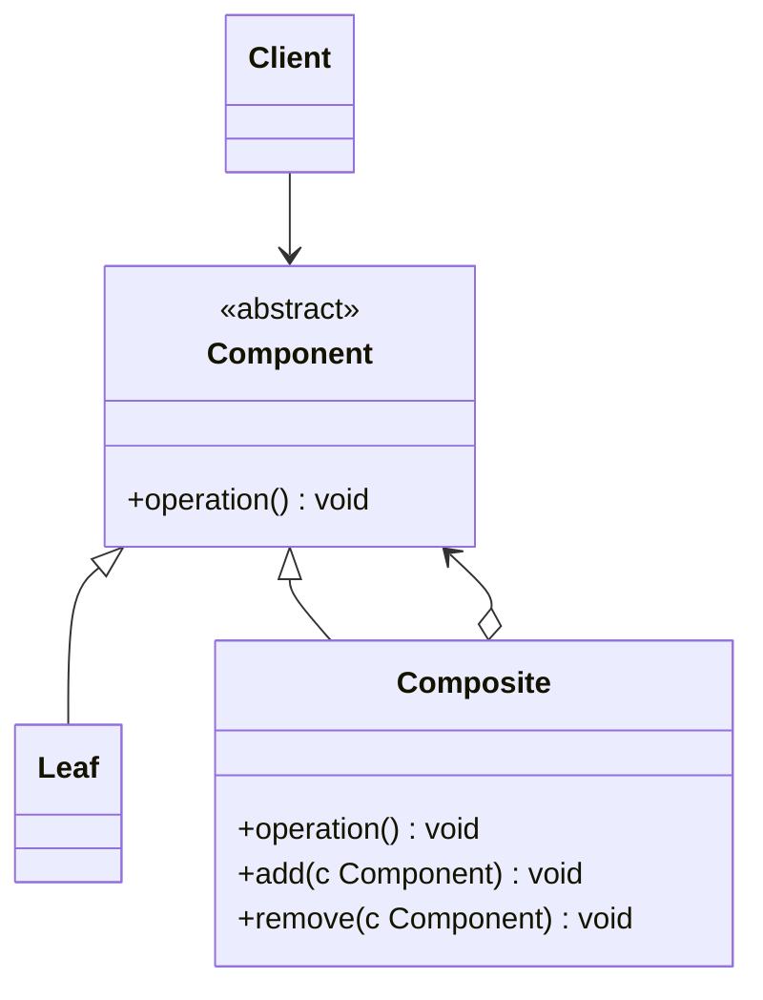

# Composite Pattern

> Composes objects into tree structures to represent part-whole hierarchies, letting clients treat individual objects and compositions uniformly.

## Intent

Composite is a **structural** design pattern. It organizes objects into a tree structure where both individual objects and compositions implement the same interface, so clients treat them uniformly without distinguishing "one" from "many".

## Problem

Sometimes you must handle a group of objects with part-whole relationships. Treating individual objects and compositions separately makes client code complex and hard to maintain.

## Solution

Composite organizes objects into a tree and defines a common component abstraction so leaf and composite nodes expose consistent operations, enabling transparent handling.

| Role | Description |
|------|-------------|
| Component | Defines the common operation interface for leaves and composites |
| Leaf | Represents a single object with no children |
| Composite | Represents a composition holding a set of children (leaves or composites) |

## Structure

- **Component**: the abstraction shared by leaves and composites.
- **Leaf**: a single object with no children.
- **Composite**: holds a collection of children, which may be leaves or other composites.
- **Client**: operates only against the component interface.

## Effects

**Pros**

- **Transparency**: clients treat individual and composite objects uniformly.
- **Simpler clients**: no need to check whether an object is single or composite.
- **Flexibility**: new leaves or composites are easy to add.

**Cons**

- **Not always suitable**: can introduce unnecessary complexity in some cases.
- **May restrict operations**: a unified interface may not cover all specific operations.

**When to use**

- When handling part-whole relationships and needing a unified, transparent access approach.

## Cases in this project

- [Organization](organization/README.md) — models a company and its departments as a tree.
- [File System](filesystem/README.md) — treats files and directories uniformly.