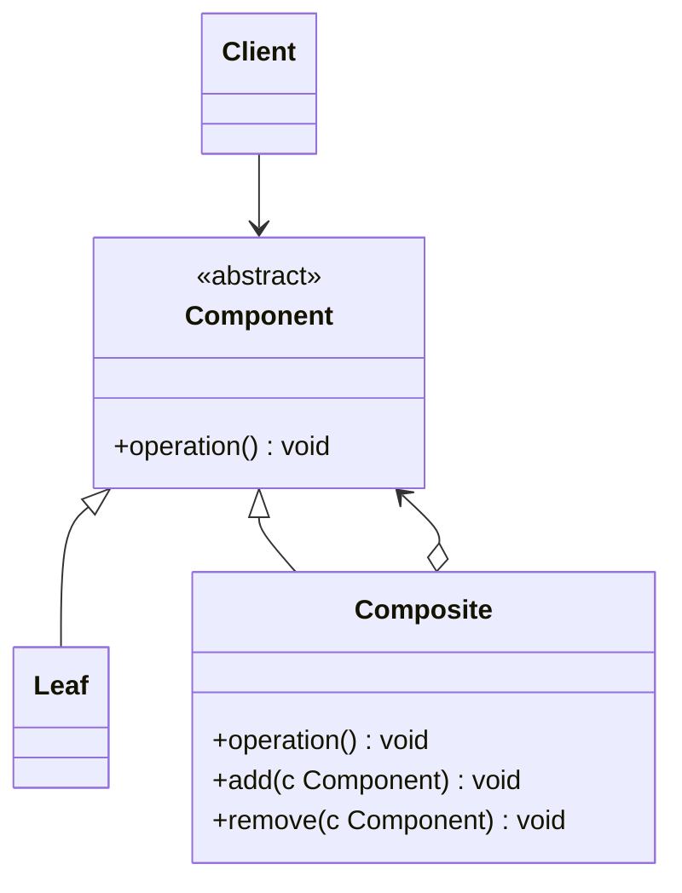

# 组合模式（Composite）

> 将对象组合成树形结构以表示「整体-部分」的层次结构，使得用户对单个对象和组合对象的使用具有一致性。

## 意图

组合模式（Composite）是一种**结构型**设计模式。它把对象组织成树状结构，让单个对象与组合对象都实现同一接口，从而让客户端能以一致的方式对待它们，无需区分「一个」还是「多个」。

## 问题

有时需要处理一组对象，它们之间存在整体-部分的关系。若对单个对象和对象组合分别特殊处理，客户端代码会变得复杂且难以维护。

## 解决方案

组合模式将对象组合成树状结构，定义共同的组件抽象，使叶子节点与复合节点对外提供一致的操作，实现透明处理。

| 角色 | 说明 |
|------|------|
| 组件 | 定义单个对象与组合对象共同的操作接口 |
| 叶子 | 表示单个对象，没有子节点 |
| 复合 | 表示对象组合，包含一组子组件（叶子或复合） |

## 结构

- **组件（Component）**：叶子与复合共有的抽象接口。
- **叶子（Leaf）**：单个对象，无子节点。
- **复合（Composite）**：持有子组件集合，可包含叶子或其他复合。
- **客户端（Client）**：只面向组件接口操作。

## 效果

**优点**

- **透明性**：客户端一致对待单个对象与组合对象。
- **简化客户端**：无需判断操作对象是单个还是组合。
- **灵活性**：方便添加新的叶子或复合对象。

**缺点**

- **并非处处适用**：在某些场景会引入不必要的复杂性。
- **可能限制操作**：统一抽象接口可能无法覆盖所有特定操作。

**适用场景**

- 处理对象的整体-部分关系、需要统一透明方式访问的场景。

## 项目中的案例

- [组织架构](organization/README_zh.md) —— 用组合表示公司与部门的树状组织。
- [文件系统](filesystem/README_zh.md) —— 用组合统一表示文件与目录。