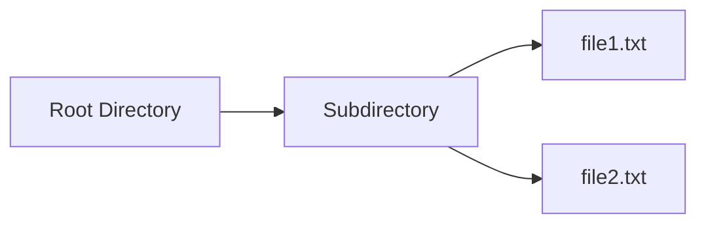
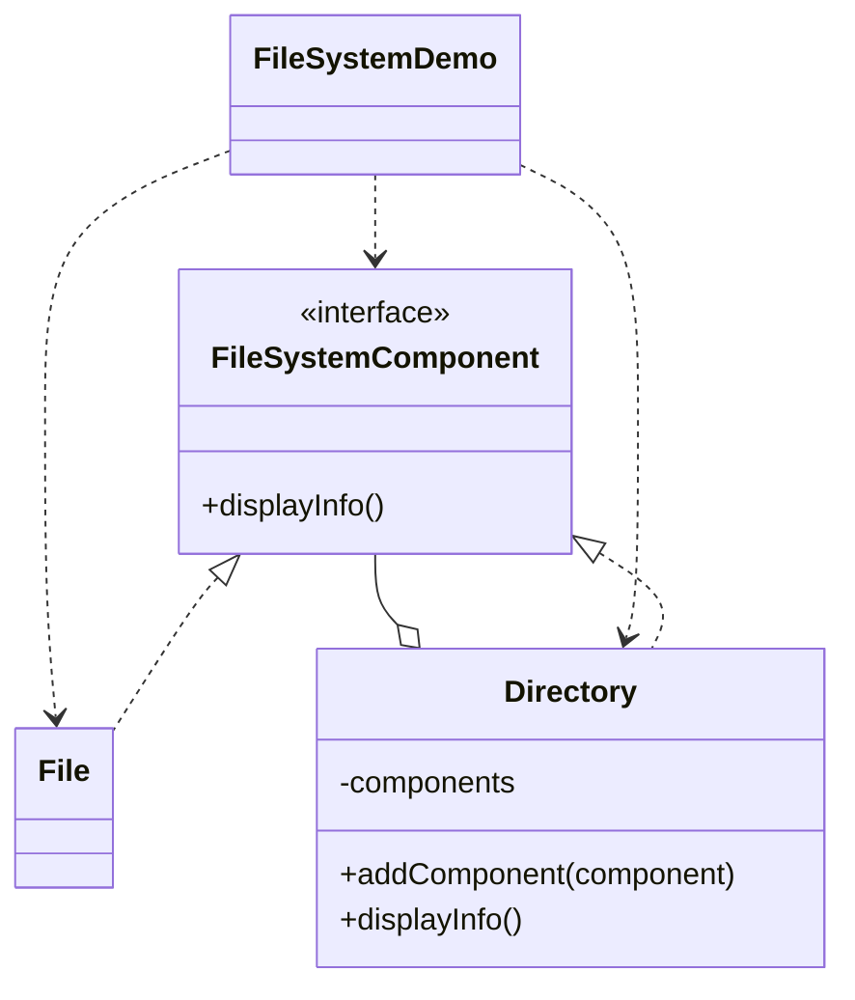

# File System — Composite

> Treats files and directories uniformly through one component interface, so a
> directory can recursively contain files and other directories.

## Big Picture

## Scenario

A file system is a tree: directories contain files and subdirectories. The
client wants to display the whole tree with a single call, without checking
whether each node is a file or a directory. A common component interface makes
both kinds of node displayable in the same way.

## Design Pattern

**Composite** — composes objects into tree structures to represent part-whole
hierarchies, letting clients treat individual objects and compositions uniformly.

Why it fits:

- `FileSystemComponent` is the **component** with `displayInfo()`.
- `File` is a **leaf**; `Directory` is a **composite** that holds children.
- `Directory.displayInfo()` recurses over children, so the client calls only the
  top node.

## Structure

| Role | Participants |
|------|--------------|
| Component | `FileSystemComponent` |
| Leaf | `File` |
| Composite | `Directory` |
| Client / demo | `FileSystemDemo` |

## Design Rationale

- A single `displayInfo()` method on both files and directories is the key move
  that removes type checks from the client.
- Recursion lives only inside `Directory`, keeping the leaf trivial.
- One file per type maps directly onto the leaf/composite split.