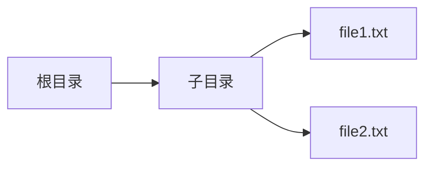
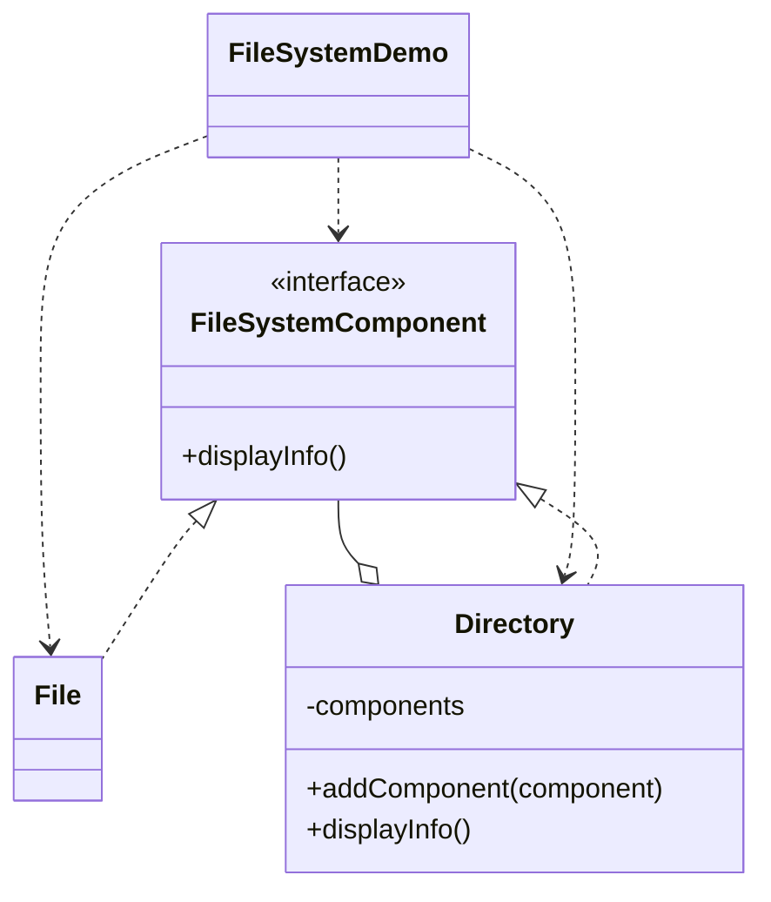

# 文件系统 — 组合

> 通过统一的组件接口同等地处理文件与目录，让目录可以递归包含文件和子目录。

## 整体概览

## 场景描述

文件系统是一棵树：目录包含文件和子目录。客户端希望只调用一次就能展示整棵树，
而无需判断每个节点是文件还是目录。统一的组件接口让两类节点都能以相同方式展示。

## 设计模式

**组合** —— 将对象组合成树形结构以表示「整体-部分」层级，使客户端能统一处理
单个对象与组合对象。

为什么匹配：

- `FileSystemComponent` 是带 `displayInfo()` 的**组件**。
- `File` 是**叶子**；`Directory` 是持有子节点的**组合**。
- `Directory.displayInfo()` 对子节点递归，客户端只需调用顶层节点。

## 结构

| 角色 | 参与者 |
|------|--------|
| 组件 | `FileSystemComponent` |
| 叶子 | `File` |
| 组合 | `Directory` |
| 客户端 / 演示 | `FileSystemDemo` |

## 设计理念

- 文件和目录共享同一个 `displayInfo()` 方法是关键所在，它消除了客户端的类型判断。
- 递归只存在于 `Directory` 内部，叶子因此保持简单。
- 一个类型一个文件，直接映射「叶子 / 组合」的划分。