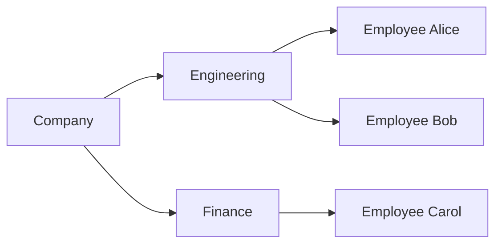
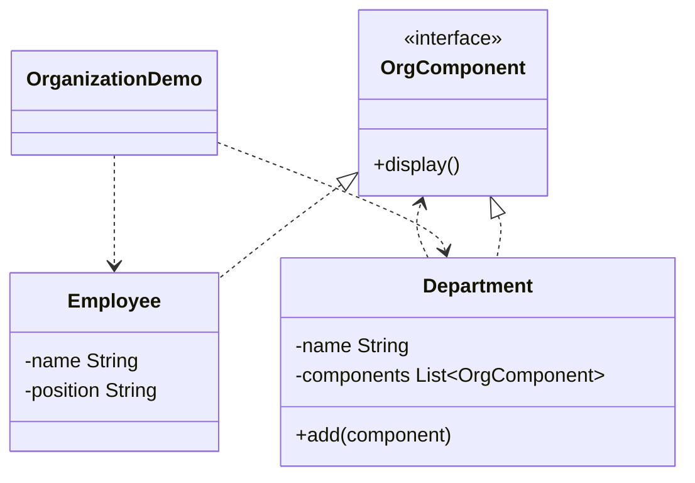

# Organization — Composite

> Treats employees and departments uniformly as a tree, so a company can be
> traversed as a whole or drilled into level by level.

## Big Picture

## Scenario

A company is organized as a tree: departments contain employees and can
contain sub-departments. The client wants to display the whole structure with
a single call, without distinguishing leaves (employees) from composites
(departments).

## Design Pattern

**Composite** — composes objects into tree structures and lets clients treat
individual and composite objects uniformly.

Why it fits:

- `OrgComponent` is the common abstraction for both leaves and containers.
- `Employee` is a **leaf**; `Department` is a **composite** that holds
  children.
- Calling `display()` on the root recurses through the whole tree.

## Structure

| Role | Participants |
|------|--------------|
| Component | `OrgComponent` |
| Leaf | `Employee` |
| Composite | `Department` |
| Client / demo | `OrganizationDemo` |

## Design Rationale

- The organization-tree scenario is intuitive and clearly distinct from the
  existing "File System" example.
- The same `display()` call works uniformly on leaves and composites,
  highlighting the pattern's core benefit.
- One file per type, following the Java convention, keeps each role readable.