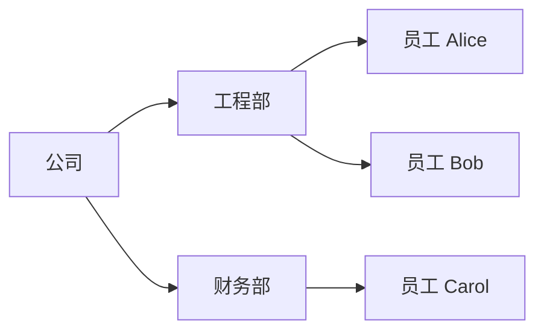
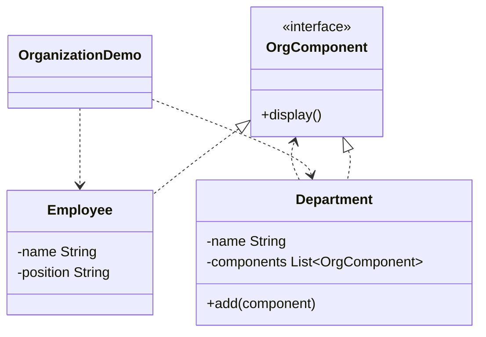

# 组织架构 — 组合

> 把员工与部门统一成一棵树，公司既能整体遍历，也能逐层下钻。

## 整体概览

## 场景描述

一家公司以树形组织：部门包含员工，也能包含子部门。客户端希望用一次调用展示整个
结构，而无需区分叶子（员工）与容器（部门）。

## 设计模式

**组合** —— 将对象组合成树形结构，让客户端能统一对待个体与组合对象。

为什么匹配：

- `OrgComponent` 是叶子与容器的统一抽象。
- `Employee` 是**叶子**，`Department` 是持有子节点的**容器**。
- 对根调用 `display()` 会递归遍历整棵树。

## 结构

| 角色 | 参与者 |
|------|--------|
| 组件 | `OrgComponent` |
| 叶子 | `Employee` |
| 容器 | `Department` |
| 客户端 / 演示 | `OrganizationDemo` |

## 设计理念

- 组织架构树的场景直观好懂，与已有的"文件系统"示例明显区分。
- 同一个 `display()` 对叶子与容器统一生效，突出该模式的核心收益。
- 遵循 Java 惯例一个类型一个文件，让每个角色都清晰可读。