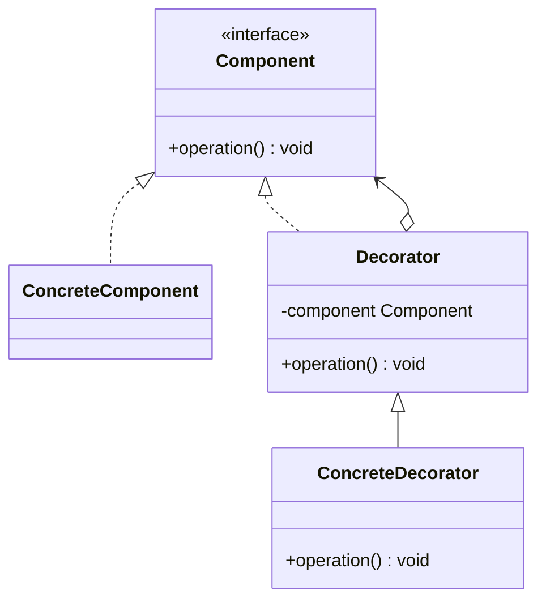

# Decorator Pattern

> Attaches additional responsibilities to an object dynamically, providing a flexible alternative to subclassing for extending functionality.

## Intent

Decorator is a **structural** design pattern. It dynamically adds functionality by wrapping the original object, without modifying its structure, avoiding the class explosion caused by inheritance.

## Problem

Sometimes you need to add functionality or responsibility without modifying an existing object's structure. Inheritance leads to class explosion, while modifying existing classes may affect other code.

## Solution

Decorator wraps the original class with a decorator class: the decorator implements the same interface as the decorated object, holds a reference to it, and can stack extra behavior. Combining different decorators builds different feature combinations.

| Role | Description |
|------|-------------|
| Component | The common interface of concrete objects and decorators |
| Concrete component | Implements the component interface and is the original object being decorated |
| Decorator | Holds a component reference and implements the component interface, forwarding requests |
| Concrete decorator | Extends the decorator, adding extra behavior |

## Structure

- **Component**: the interface shared by the decorated object and the decorator.
- **ConcreteComponent**: the original object.
- **Decorator**: holds a component reference and forwards requests.
- **ConcreteDecorator**: adds extra behavior before or after forwarding.

## Effects

**Pros**

- **Avoids class explosion**: various feature combinations come from composing a few decorators.
- **Flexible change**: adding or modifying functionality does not affect other code.

**Cons**

- **Many small classes**: can produce many small decorator classes, increasing complexity.

**When to use**

- When you need to add stackable functionality dynamically without modifying existing classes.

## Cases in this project

- [Data Stream](datastream/README.md) — stacks encryption, compression and more onto a data stream.
- [Coffee Topping](coffeetopping/README.md) — dynamically adds sugar, milk and other toppings to coffee.