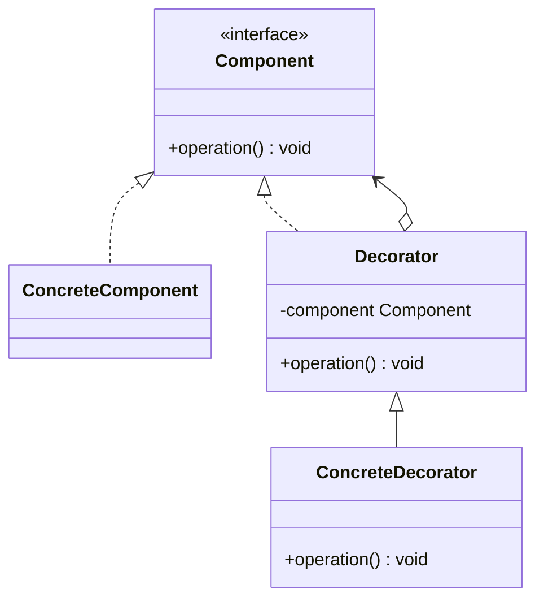

# 装饰模式（Decorator）

> 动态地给一个对象添加一些额外的职责，就增加功能来说，装饰模式比生成子类更灵活。

## 意图

装饰模式（Decorator）是一种**结构型**设计模式。它在不修改现有对象结构的前提下，通过包装原始对象来动态地添加功能，避免了继承带来的类爆炸问题。

## 问题

有时需要在不修改现有对象结构的情况下动态添加功能或职责。用继承会导致类爆炸，修改现有类又可能影响其他代码。

## 解决方案

装饰模式创建装饰类来包装原始类：装饰类与被装饰对象实现同一接口，内部持有被装饰对象引用，可叠加额外功能，并通过组合不同装饰类构建不同功能组合。

| 角色 | 说明 |
|------|------|
| 组件 | 具体对象与装饰器共有的接口 |
| 具体组件 | 实现组件接口，是被装饰的原始对象 |
| 装饰器 | 持有组件引用并实现组件接口，可转发请求 |
| 具体装饰器 | 扩展装饰器，添加额外功能 |

## 结构

- **组件（Component）**：被装饰对象与装饰器共有的接口。
- **具体组件（ConcreteComponent）**：原始对象。
- **装饰器（Decorator）**：持有组件引用，转发请求。
- **具体装饰器（ConcreteDecorator）**：在转发前后添加额外功能。

## 效果

**优点**

- **避免类爆炸**：通过组合少量装饰类实现各种功能组合。
- **灵活增改**：功能的增加与修改不影响其他代码。

**缺点**

- **小类增多**：可能产生大量小型装饰类，增加代码复杂性。

**适用场景**

- 需要动态、可叠加地为对象添加功能，且不希望修改原有类的场景。

## 项目中的案例

- [数据流装饰](datastream/README_zh.md) —— 用装饰器为数据流叠加加密、压缩等功能。
- [咖啡加料](coffeetopping/README_zh.md) —— 用装饰器为咖啡动态叠加糖、奶等配料。