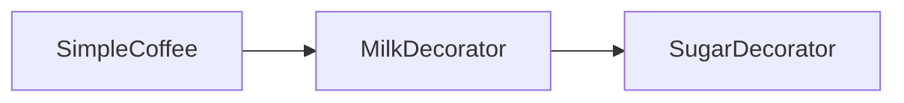
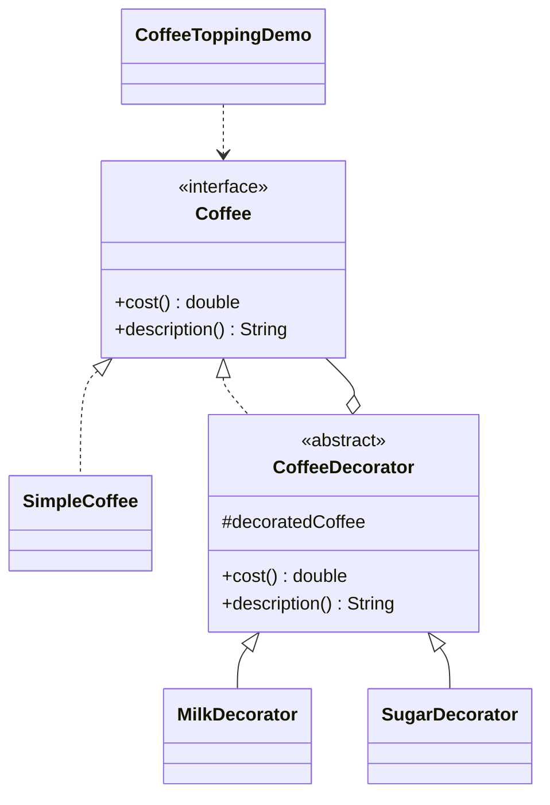

# Coffee Topping — Decorator

> Adds milk and sugar to a base coffee by wrapping it in decorators, composing
> cost and description without modifying the base class.

## Big Picture

## Scenario

A coffee shop sells a base coffee plus optional toppings. Rather than creating a
class for every combination, each topping is a decorator that wraps another
`Coffee` and adds its own cost and description. Milk over sugar over plain
coffee yields the final price and description.

## Design Pattern

**Decorator** — attaches additional responsibilities to an object dynamically,
providing a flexible alternative to subclassing.

Why it fits:

- `Coffee` is the **component**; `SimpleCoffee` is the **concrete component**.
- `CoffeeDecorator` is the **decorator** that holds and forwards to a wrapped
  `Coffee`.
- `MilkDecorator`/`SugarDecorator` add cost and description on top of the delegate.

## Structure

| Role | Participants |
|------|--------------|
| Component | `Coffee` |
| Concrete component | `SimpleCoffee` |
| Decorator | `CoffeeDecorator` |
| Concrete decorators | `MilkDecorator`, `SugarDecorator` |
| Client / demo | `CoffeeToppingDemo` |

## Design Rationale

- Decorators delegate the base behavior via `super.cost()`/`super.description()`
  and only add their own increment, which keeps each topping independent.
- Wrapping order matters and is visible in the demo: sugar wraps milk wraps base.
- One file per type keeps component, decorator and toppings distinct.