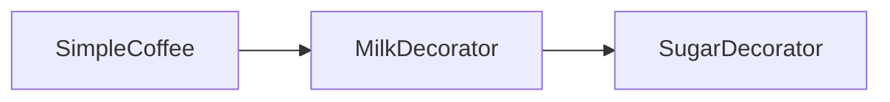
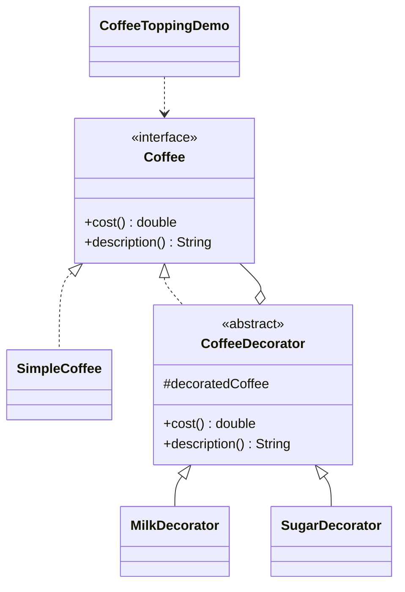

# 咖啡加料 — 装饰

> 通过装饰者给基础咖啡叠加牛奶和糖，在不改动基础类的前提下组合出价格与描述。

## 整体概览

## 场景描述

咖啡店出售基础咖啡并可选加料。与其为每种组合都建一个类，不如让每种加料成为
装饰者，包装另一个 `Coffee` 并追加自己的价格与描述。「糖包牛奶包纯咖啡」即可
得到最终价格与描述。

## 设计模式

**装饰** —— 动态地给对象附加额外职责，是比继承更灵活的替代方案。

为什么匹配：

- `Coffee` 是**组件**；`SimpleCoffee` 是**具体组件**。
- `CoffeeDecorator` 是持有并转发被包装 `Coffee` 的**装饰者**。
- `MilkDecorator`/`SugarDecorator` 在委托之上追加价格与描述。

## 结构

| 角色 | 参与者 |
|------|--------|
| 组件 | `Coffee` |
| 具体组件 | `SimpleCoffee` |
| 装饰者 | `CoffeeDecorator` |
| 具体装饰者 | `MilkDecorator`、`SugarDecorator` |
| 客户端 / 演示 | `CoffeeToppingDemo` |

## 设计理念

- 装饰者通过 `super.cost()`/`super.description()` 转发基础行为，只追加自己的
  增量，使每种加料彼此独立。
- 包装顺序在演示中清晰可见：糖包牛奶包基础咖啡。
- 一个类型一个文件，组件、装饰者与加料各归其位。