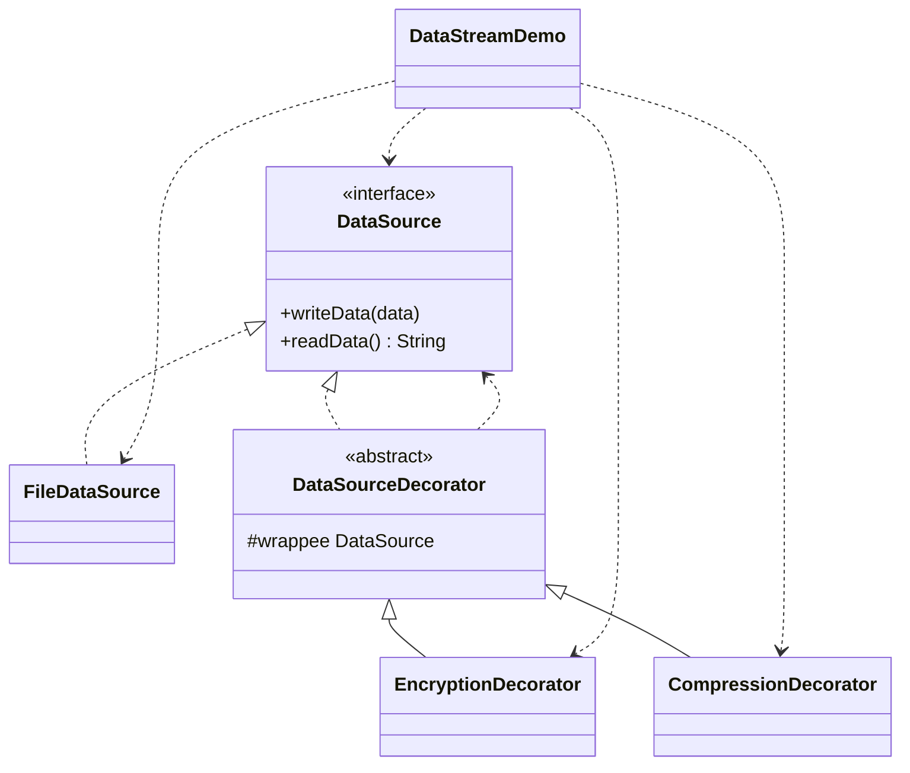

# Data Stream — Decorator

> Wraps a data source with encryption and compression layers that can be
> stacked in any order at runtime.

## Big Picture

## Scenario

A file stores raw text. We sometimes want to write it encrypted, sometimes
compressed, sometimes both. Instead of building many subclasses for every
combination, each capability is a decorator that wraps a `DataSource` and
adds one behavior, letting the client compose them as needed.

## Design Pattern

**Decorator** — attaches additional responsibilities to an object dynamically
without changing its interface.

Why it fits:

- `DataSource` is the shared interface; `FileDataSource` is the base object.
- `DataSourceDecorator` forwards calls by default, so concrete decorators
  only add their own behavior.
- Decorators can be nested arbitrarily (`Compression(Encryption(file))`).

## Structure

| Role | Participants |
|------|--------------|
| Component | `DataSource` |
| Concrete component | `FileDataSource` |
| Decorator | `DataSourceDecorator` |
| Concrete decorators | `EncryptionDecorator`, `CompressionDecorator` |
| Client / demo | `DataStreamDemo` |

## Design Rationale

- The classic GoF data-stream example shows how decorators compose into
  pipelines, clearly distinct from "Coffee Topping".
- Nesting encryption and compression demonstrates the runtime-composition
  power that inheritance cannot provide.
- One file per type, following the Java convention, keeps each role readable.