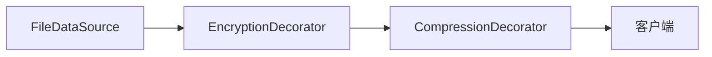
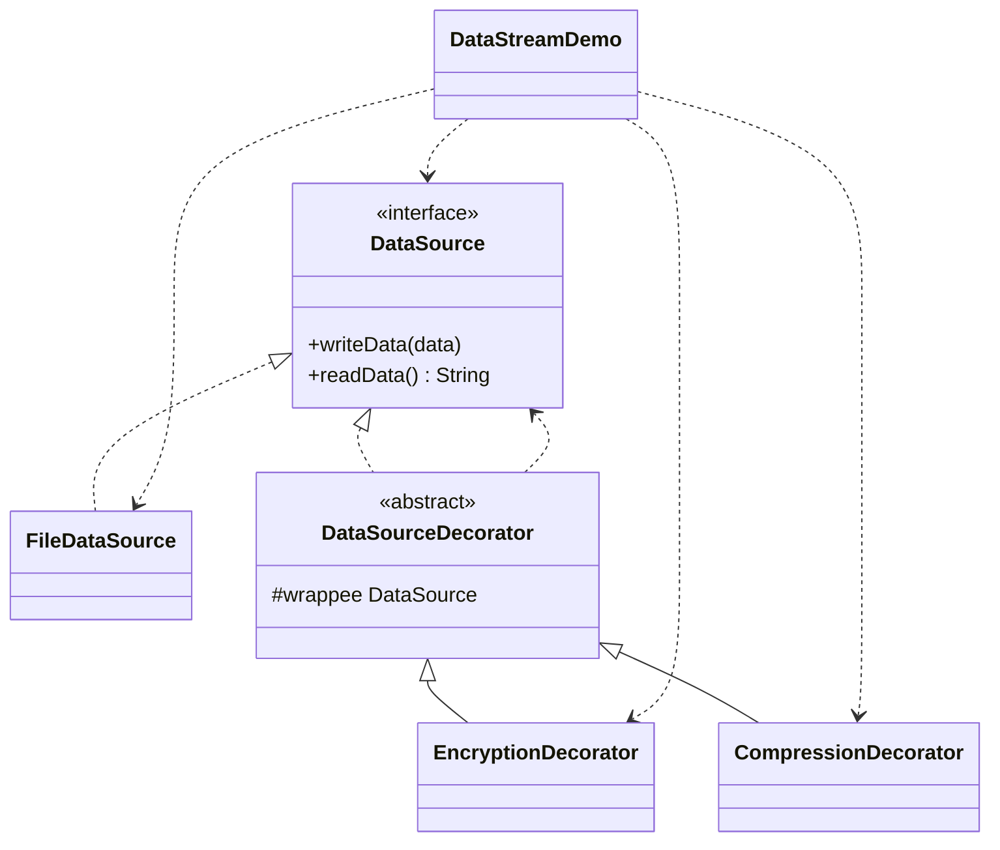

# 数据流装饰 — 装饰

> 用加密、压缩等装饰层包装数据源，且可以在运行时任意顺序叠加。

## 整体概览

## 场景描述

一个文件存储原始文本。我们有时想加密写入，有时想压缩，有时两者都要。与其为每种
组合都建子类，不如把每种能力做成一个装饰器，包装一个 `DataSource` 并叠加一种
行为，让客户端按需组合。

## 设计模式

**装饰** —— 在不改变接口的前提下，为对象动态附加职责。

为什么匹配：

- `DataSource` 是共享接口，`FileDataSource` 是基础对象。
- `DataSourceDecorator` 默认转发调用，具体装饰器只需追加自己的行为。
- 装饰器可任意嵌套（如 `Compression(Encryption(file))`）。

## 结构

| 角色 | 参与者 |
|------|--------|
| 组件 | `DataSource` |
| 具体组件 | `FileDataSource` |
| 装饰者 | `DataSourceDecorator` |
| 具体装饰者 | `EncryptionDecorator`、`CompressionDecorator` |
| 客户端 / 演示 | `DataStreamDemo` |

## 设计理念

- 这是 GoF 数据流的经典示例，直观展示装饰器如何组合成流水线，与"咖啡加料"明显区分。
- 嵌套加密与压缩，展示了继承所无法提供的运行时组合能力。
- 遵循 Java 惯例一个类型一个文件，让每个角色都清晰可读。